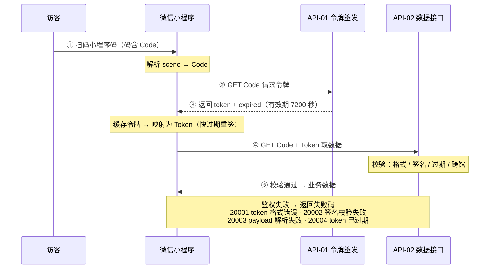

# 博物馆预约管理系统 · 数据接口文档

## 目录

- [基本信息](#基本信息)
- [通则](#通则)
- [接口鉴权方式](#接口鉴权方式)
- [API-01 签发前端访问令牌](#api-01-签发前端访问令牌)
- [API-02 按场馆编号查询场馆主页信息](#api-02-按场馆编号查询场馆主页信息)
- [API-03 按展区 ID 查询展区详情与展品列表](#api-03-按展区-id-查询展区详情与展品列表)
- [API-04 按展品 ID 查询展品详情](#api-04-按展品-id-查询展品详情)
- [API-05 场馆预约提交](#api-05-场馆预约提交)
- [API-06 微信登录（手机号 / js_code 两种形式）](#api-06-微信登录手机号-js_code-两种形式)
- [API-07 我的预约（列表 / 详情 / 入场凭证）](#api-07-我的预约列表-详情-入场凭证)
- [API-08 提交反馈](#api-08-提交反馈)
- [API-09 取消预约](#api-09-取消预约)
  - [API-10 更新用户信息](#api-10-更新用户信息)
  - [API-11 获取个人信息与预约记录列表](#api-11-获取个人信息与预约记录列表)
  - [附录](#附录)
  - [附录 A 接口环境地址汇总](#附录-a-接口环境地址汇总)
  - [附录 B 字段口径约定](#附录-b-字段口径约定)
  - [附录 C 状态码编码库](#附录-c-状态码编码库)
- [更新记录](#更新记录)

## 基本信息

| 字段    | 内容                                                  |
| ----- | --------------------------------------------------- |
| 文档版本号 | 1.9.6                                              |
| 创建人   | 周子濠                                                 |
| 创建时间  | 2026-11-05                                          |
| 阅读对象  | 前后端开发工程师、联调与测试人员                                    |
| 用途描述  | 定义全部数据接口契约（地址 / 参数 / 响应 / 环境），作为系统对接与联调的唯一事实源（SSOT） |
| 变更管理  | 博物馆预约管理系统-变更管理文档（第 5 册） |

## 通则

本文件为系统对接与联调的**唯一事实源（SSOT）**。以下规则一次性约定全部命名、口径、避坑与规范要求；各接口章节仅描述自身差异，**不再重复**本通则已约定的内容。

### 1. 响应命名规范（集合 / 单对象）

响应 `data` 内承载实体数据时，按**基数**统一命名 key：

- **多条记录（集合）**：`xxxxList`，`xxxx` 为实体名称（单数、首字母大写）。例：展区集合 → `ExhibitionAreaList`；展品集合 → `ExhibitList`。
- **单个对象**：`xxxxInfo`，`xxxx` 为实体名称。例：场馆 → `MuseumInfo`；展区 → `ExhibitionAreaInfo`；展品 → `ExhibitInfo`。
- **主响应实体**同样以 `xxxxInfo` 包裹于 `data` 内，不再平铺于 `data` 顶层。

### 2. 错误码与成功判据

- **成功判据**：顶层 `code` 为空 / `0` / `1`，且 `data` 含有效字段（如 `Name`）。
- **自定义错误码 9xxxx**：本项目所有业务错误码均为自定义 `9xxxx` 体系（见附录 C 状态码编码库），如 `90001` 场馆不存在、`90003` 展区不存在、`90004` 展品不存在、`90006` 微信登录失败、`90008` 预约记录不存在。
- **微信原生 errcode 禁止透传**：微信 `jscode2session` 等原生 `errcode`（如 `40029` code 无效 / 过期、`45011` 频率限制）**不可直接对外**，必须映射为对应的项目 `9xxxx` 码后返回；微信登录失败统一映射 `90006`，`data` 为空。
- **「xxx不存在」统一格式**：所有"根据指定条件查询"的查无结果，错误输出统一为「xxx不存在」（如 `场馆不存在` / `展区不存在` / `展品不存在` / `预约记录不存在`），且不返回 `data`。

### 3. 参数键大小写

所有入参键均为**大写开头、区分大小写**（如 `Code` / `Token` / `ExhbitAreaId` / `ExhibitId` / `WxCode`）；传小写（如 `code`）会被判「参数缺少必填项」。区分 GET（query 参数）与 POST（JSON body）两种传参形态，两者均按上述键名解析。同一接口可同时使用 query 与 body（如 API-10 以 query 传鉴权参数、body 传业务字段），键名规则一致。

### 4. 草案口径

标注「草案口径」的字段（如 API-03 的 `ExhibitList`、API-04 的 `ExhibitInfo`、API-06 的 `UserId` / `NickName` / `AvatarUrl` / `IsRegistered`、API-08 的 `FeedbackId` 等），其数据源与字段口径**待明道云侧建表 / 字段回填后补全**，非最终契约；以明道云工作表为准。展品实体（Exhibit）工作表在博物馆预约应用内新建（关联所属场馆 Museum 与所属展区 ExhibitionArea），或由陈琦「馆藏数字化」项目复用，字段待建表后补全。

### 5. 文档契约 vs 线上实现差异

文档契约为**设计事实源**。截至 2026-11-09 实测，API-02（`MuseumInfo` + `ExhibitionAreaList` + `Photos`）、API-03（`ExhibitionAreaInfo` + `ExhibitList`）、API-04（`ExhibitInfo`）的响应键名与字段结构均已与本文档对齐，原「平铺 / 旧键名 `ExhibitionArea` / `Exhibits` / `Exhibit`」差异已闭环。剩余差异仅字段级（顶层 `code` 字符串 / 数值类型不一致，见附录），仍以本文档字段表为准。

### 6. 接口状态块

每个接口仅保留一项状态：**已就绪（接口设计完成，可对接）**；其余开发 / 联调状态不在文档中陈列。

### 7. 已知待统一项

- `Status` 口径：博物馆（Museum）`Status` 保留（控制放号）；展区（ExhibitionArea）`Status` 已按需求移除。实体模型候选值「开放 / 闭馆」与接口实测值「开放 / 关闭」口径待统一（见附录 B）。

## 接口鉴权方式

本系统**对外数据接口共两类**（API-01、API-02），鉴权与传参要求相同：小程序前端经明道云工作流 Webhook（hooks2）与后端交互，统一以 **HTTPS GET + query 参数**传参；入参键区分大小写。API-02 入参 `Code`（场馆编号）+ `Token`（前端访问令牌）；API-01 入参 `Code`（场馆编号）。令牌由 API-01 签发与校验（签发响应字段名为 `token`），密钥仅存服务端，前端零高权限密钥。

> 字段映射：API-01 响应 `token` → API-02 入参 `Token`；场馆编号两接口均为 `Code`。

> 微信 AppSecret / 明道云应用密钥等高权限凭证**仅存明道云侧**，绝不下发小程序前端。前端换令牌 / 取数据均以小程序码解析得到的场馆编号为唯一业务标识，并持签发的临时令牌（API-02 入参名 `Token`）。

**同名词义对照**

| 键 | 位置与含义 |
| --- | --- |
| `Code` | API-01 / API-02 请求入参，场馆编号（大写 C） |
| `Token` | API-02 请求入参，前端访问令牌 |
| `code` | 响应顶层，状态码 |
| `Code` | 响应 `data` 内，场馆编号回显 |
| `token` | API-01 响应字段，签发的前端访问令牌；前端映射为 `Token` 传入 API-02 |
| `expired` | API-01 响应字段，令牌有效期（秒） |



> 时序图说明：访客扫码（码含场馆编号）→ 小程序解析 scene 得编号 → ② GET 携 `Code` 调 API-01 换令牌 → ③ 取回 `token` + `expired`（绑定场馆 appId，有效期 7200 秒）→ ④ 前端将令牌映射为 `Token`，GET 携 `Code` + `Token` 调 API-02 取数据 → ⑤ API-02 校验令牌（格式 / 签名 / 过期 / 跨馆）→ 校验通过返业务数据，失败返鉴权失败码（20001~20004）。

## API-01 签发前端访问令牌

**状态**

- [x] 已就绪（2026-11-06 实测签发与查询链路通过）

---

- 名称：签发前端访问令牌
- 描述：小程序前端解析小程序码得到场馆编号后，以 GET 携 `Code` 请求；服务端签发 `token` 并返回；后续前端调用数据接口须以 GET 携带 `Code` 与 `Token` 鉴权，其中 `Token` 由 `token` 映射而来。
- 发起方：小程序前端
- 响应方：明道云后端（HAP）
- 请求地址（按环境区分）：
  - 开发环境：`https://api.mingdao.com/workflow/hooks2/NmFlZDc2NGNlOTVhYTgwMjYzNzE3ZGMz`
  - 正式环境：待完善
- 接口协议：HTTPS GET（query 参数；入参键 `Code` 大写、区分大小写）；实测 POST + JSON body 亦可解析
- 请求参数：
  | 参数 | 类型 | 必填 | 说明 |
  | --- | --- | --- | --- |
  | `Code` | 文本 | 是 | 场馆编号，小程序码 scene 解析所得；传小写 `code` 报 `[Code] 参数缺少必填项` |
- 请求示例：`GET https://api.mingdao.com/workflow/hooks2/NmFlZDc2NGNlOTVhYTgwMjYzNzE3ZGMz?Code=220261105083`
- 响应参数（**顶层直接返回，无 `data` 包装**）：

  成功：
  ```json
  {
    "msg": "",
    "expired": 7200,
    "code": "",
    "token": "eyJhcHBJZCI6IjEyMyIsImlhdCI6MTc5Mzk2NDE4MDAxNCwiZXhwIjoxNzkzOTcxMzgwMDE0LCJqdGkiOiIyODVjMmRmNDAzYmZmY2YxIn0.F06vVjOyRe-OYmI9GCxWdm_hwHsLSxuyyfW3XP1uL2o"
  }
  ```

  场馆不存在：
  ```json
  {
    "msg": "场馆不存在",
    "expired": "",
    "code": 90001.0,
    "token": ""
  }
  ```

- 字段说明：
  | 字段 | 说明 |
  | --- | --- |
  | `token` | 短期访问令牌；前端缓存后映射为 API-02 入参 `Token` 携带；有效期内可重复使用 |
  | `expired` | 令牌有效期（秒）；成功 `7200`，失败为空字符串 |
  | `code` | 状态码；成功为空字符串，失败为数值 `90001.0`，与 API-02 的字符串 `"90001"` 类型不一致，待统一 |
  | `msg` | 状态描述；成功为空字符串 |

- 令牌结构（2026-11-06 实测）：
  | 项 | 内容 |
  | --- | --- |
  | 段数 | 两段式 `payload.signature`，无 header 段 |
  | payload | base64url 编码 JSON：`{"appId":"123","iat":1793964180014,"exp":1793971380014,"jti":"285c2dfd403bff2cf1"}` |
  | 字段 | `appId` 场馆应用标识；`iat` 签发时间、`exp` 过期时间，均为毫秒时间戳；`jti` 令牌随机标识 |
  | 有效期 | 7200 秒，`exp - iat = 7200000` 毫秒 |
  | 签名 | 明道云侧密钥计算，前端不持有算法与密钥 |
  | 校验顺序 | 格式（段数 = 2）→ 签名 → payload → 过期 → 跨馆；跨馆令牌返回 `20002` |

- 备注：① 令牌生成与验证算法、密钥仅在明道云工作流侧，小程序仅持票；② `Code` 为小程序码解析所得的场馆编号，每馆独立小程序对应唯一编号，不提供保密性；③ 令牌绑定场馆 `appId` 做多馆隔离，实测跨馆调用返回 `20002`；④ 场馆不存在时签发接口返回 `90001`，不签发令牌；⑤ 状态码见「附录 C 状态码编码库」。

## API-02 按场馆编号查询场馆主页信息

**状态**

- [x] 已就绪（接口设计完成，可对接）

---

- 名称：按场馆编号查询场馆主页信息
- 描述：游客扫码后由小程序前端触发，按 `Code` 查询并返回该场馆主页所需字段（名称 / 类型 / 地址 / 状态 / 照片 / 介绍 / 联系方式）、本馆展区列表与可预约日期列表。
- 发起方：小程序前端（游客扫码后调用工作流钩子）
- 响应方：明道云后端（HAP）
- 请求地址（按环境区分）：
  - 开发环境：`https://api.mingdao.com/workflow/hooks2/NmFlYzhlNGJjNjdlZGFjNTg2ZTE3NWNh`
  - 正式环境：待完善（正式环境工作流发布后填入对应 hooks2 地址）
- 接口协议：HTTPS GET（query 参数；入参键 `Code` / `Token` 均为大写开头、区分大小写）；实测 POST + JSON body 亦可解析
- 请求参数（见「接口鉴权方式」）：
  | 参数 | 类型 | 必填 | 说明 |
  | --- | --- | --- | --- |
  | `Code` | 文本 | 是 | 场馆编号，小程序码 scene 解析所得；传小写 `code` 报 `[Code] 参数缺少必填项` |
  | `Token` | 文本 | 是 | API-01 响应字段 `token` 映射而来；未携带或空值报 `[Token] 参数缺少必填项` |
- 请求示例：`GET https://api.mingdao.com/workflow/hooks2/NmFlYzhlNGJjNjdlZGFjNTg2ZTE3NWNh?Code=220261105083&Token={token}`
- 响应参数（命中时，`data` 为对象）：`code` / `msg` 为接口状态字段；成功判据为 `code` 空 / `0` / `1` 且 `data` 含有效字段（如 `Name`）。
  > 以下为 2026-11-10 实测开发环境**成功态**返回（`Code=220261105083` + 有效 `Token`）：顶层 `code` / `msg` 均为空字符串；`data` 含场馆对象（`MuseumInfo`）、展区列表（`ExhibitionAreaList`）与可预约日期列表（`ReservationDateList`）。`ExhibitionAreaList` 项为对象，含 `ID` / `Code` / `Name` / `Location` / `Photos`（图片 URL 数组，无值返回 `[]`）。`ReservationDateList` 项含 `ID` / `Date` / `DailyQuota` / `DailyUsed` / `CanReserve` / `SessionId` / `SessionName`，按日期×时段。关闭态 `90002` 实测**不返回 `data`**。本次新增的 `NeedVerify` 字段尚未纳入该实测快照，待上线后返回，字段定义见下表。

  ```json
  {
    "code": "",
    "msg": "",
    "data": {
      "MuseumInfo": {
        "Code": "220261105083",
        "Name": "辛亥革命纪念馆",
        "Status": "开放",
        "BusinessHours": "周一、周二、周三、周四、周五、周六；08:00-17:00",
        "Location": "420100",
        "Type": "博物馆",
        "Photos": [
          "https://p1.mingdaoyun.cn/2f800248-8f57-4efd-a652-953cd735763a/82436c94-f896-4531-abbb-5679d5138d6f/6adf085ff0000ebe5b3d9ed9/20261105/b3eQ6y4d6q8A4saF987d436WcF634SbQcc0Z4ufR4s7e1MdKfp46aU376D2M4E7H.png?attname=image.png&e=1794309939&token=mN_sp-Y4_5zePppXZC8fTktRmKMNiYlC8jl_yeGZ:_GVdNdPG0qvVDzlVch6ksuc-zMY="
        ],
        "Introduction": "<p>博物馆很好看</p>",
        "Address": "民主路123号",
        "ContactPhone": "010-54512232",
        "ContactMobile": "+8613355451777"
      },
      "ExhibitionAreaList": [
        {
          "ID": "73a8168b-0877-41cd-953b-c5d43e56fda1",
          "Code": "ZX-001",
          "Name": "晚清风云展区",
          "Location": "一层东厅",
          "Photos": [
            "https://p1.mingdaoyun.cn/pic/202509/B976D679-6DAD-40F8-A824-54D732FC098B.png?attname=%e6%99%9a%e6%b8%85%e9%a3%8e%e4%ba%91%e5%b1%95%e5%8c%ba.png&e=1794309938&token=mN_sp-Y4_5zePppXZC8fTktRmKMNiYlC8jl_yeGZ:49mkyjrscGTP-s0O36CHCb7keTU="
          ]
        }
      ],
      "ReservationDateList": [
        {
          "ID": "b7c3f2a1-6d54-4e88-9b30-1c7e5a2d84f6",
          "Date": "2026-11-17 00:00:00",
          "SessionId": "",
          "SessionName": "",
          "DailyQuota": 1000,
          "DailyUsed": 0,
          "CanReserve": 1
        },
        {
          "ID": "c8d4g3b2-7e65-4f99-0c41-2d8f6b3e95g7",
          "Date": "2026-11-17 00:00:00",
          "SessionId": "a1b2c3d4-0000-1111-2222-333344445555",
          "SessionName": "上午",
          "DailyQuota": 500,
          "DailyUsed": 0,
          "CanReserve": 1
        }
      ]
    }
  }
  ```
- 字段说明（按实测返回顺序，共 14 项；另含 1 项本次新增待上线字段）：
  | 字段 | 说明 |
  | --- | --- |
  | `MuseumInfo` | 场馆完整信息对象（单对象）；无值时按 `90001` 处理（不返回 `data`） |
  | `MuseumInfo.Code` | 场馆编号（与入参同值，回显） |
  | `MuseumInfo.Name` | 场馆名称 |
  | `MuseumInfo.Status` | 开放状态（源字段 `json.status`）；实测值「开放」/「关闭」，实体模型候选「开放 / 闭馆」口径待确认 |
  | `MuseumInfo.BusinessHours` | 营业时间（文本）；实测格式为「开放星期 + 分号 + 营业时段」，如「周一、周二、周三、周四、周五、周六；08:00-17:00」 |
  | `MuseumInfo.Location` | 所在地（行政区码） |
  | `MuseumInfo.Type` | 场馆类型（候选值：博物馆 / 纪念馆）；上游未传时默认 `未知` |
  | `MuseumInfo.Photos` | 场馆照片，`图片 URL 数组`；无值时返回 `[]`；前端直接取 URL 渲染 |
  | `MuseumInfo.Introduction` | 场馆介绍，**HTML 富文本** |
  | `MuseumInfo.Address` | 详细地址 |
  | `MuseumInfo.ContactPhone` | 联系电话（固定电话） |
  | `MuseumInfo.ContactMobile` | 联系手机 |
  | `MuseumInfo.NeedVerify` | 是否需要核销预约（布尔）：`true` 生成核销码并现场核销，`false` 提交成功即完成、仅发预约码；本次新增，待上线后返回（当前实测快照未含） |
  | `ExhibitionAreaList` | 本馆展区列表（对象数组）；无值时返回 `[]`；数组项字段见下表 |
  | `ReservationDateList` | 本馆可预约日期列表（对象数组）；按日期×时段，未配置时段时为全天每天一条（SessionId / SessionName 为空）；无值时返回 `[]`；数组项字段见下表 |

- `ExhibitionAreaList` 数组项字段：
  | 字段 | 说明 |
  | --- | --- |
  | `ExhibitionAreaList[].ID` | 展区记录 ID（GUID，关联记录底层 id） |
  | `ExhibitionAreaList[].Code` | 展区编号 |
  | `ExhibitionAreaList[].Name` | 展区名称 |
  | `ExhibitionAreaList[].Location` | 展区所在位置 |
  | `ExhibitionAreaList[].Photos` | 展区照片，`图片 URL 数组`；无值时返回 `[]` |

- `ReservationDateList` 数组项字段：
  | 字段 | 说明 |
  | --- | --- |
  | `ReservationDateList[].ID` | 日历记录 ID（GUID，关联记录底层 id） |
  | `ReservationDateList[].Date` | 可预约日期（`YYYY-MM-DD HH:mm:ss`） |
  | `ReservationDateList[].DailyQuota` | 该日期名额上限；生成时取场馆「每日预约名额上限」写入 |
  | `ReservationDateList[].DailyUsed` | 该日期已占用名额；随预约与取消实时增减 |
  | `ReservationDateList[].CanReserve` | 该日期是否可预约（布尔）：`1` 可预约，`0` 不可预约；名额未占用即为可预约 |
| `ReservationDateList[].SessionId` | 时段记录 ID（GUID，关联预约时段）；未配置时段时为空字符串，表示全天 |
| `ReservationDateList[].SessionName` | 场次名称（如 上午 / 下午）；未配置时段时为空字符串，表示全天 |

## API-03 按展区 ID 查询展区详情与展品列表

**状态**

- [x] 已就绪（2026-11-09 开发环境 webhook 已发布，实测可用）

---

- 名称：按展区 ID 查询展区详情与展品列表
- 描述：游客在博物馆主页点击展区后由小程序前端触发，按 `AreaId` 查询并返回该展区的完整信息（名称 / 位置 / 简介 / 图片）及该展区下的展品列表。
- 发起方：小程序前端（游客点击展区后调用工作流钩子）
- 响应方：明道云后端（HAP）
- 请求地址（按环境区分）：
  - 开发环境：https://api.mingdao.com/workflow/hooks2/NmFmMTY2ODJhNWVhODMyNGI2MDE2MGNk
  - 正式环境：待完善（正式环境工作流发布后填入对应 hooks2 地址）
- 接口协议：HTTPS GET（query 参数；入参键 `Code` / `Token` / `ExhbitAreaId` 均为大写开头、区分大小写）；实测 POST + JSON body 亦可解析
- 请求参数（沿用 API-01 / API-02 鉴权范式）：
  | 参数 | 类型 | 必填 | 说明 |
  | --- | --- | --- | --- |
  | `Code` | 文本 | 是 | 场馆编号，小程序码 scene 解析所得；传小写 `code` 报 `[Code] 参数缺少必填项` |
  | `Token` | 文本 | 是 | API-01 响应字段 `token` 映射而来；未携带或空值报 `[Token] 参数缺少必填项` |
  | `ExhbitAreaId` | 文本 | 是 | 展区 ID（GUID），API-02 返回的 `ExhibitionAreaList[].ID`；标识要查看的展区；**线上入参键名为 `ExhbitAreaId`（拼写如此）** |
- 请求示例：`GET {hooks2}/?Code=220261105083&Token={token}&ExhbitAreaId=05b2e814-bcea-4f44-8606-12e2b5c3a7aa`
- 响应参数（`data` 为对象）：`code` / `msg` 为接口状态字段；成功判据见「通则 §2」；展区信息包裹于 `ExhibitionAreaInfo`、展品列表为 `ExhibitList`（见下方示例与字段说明）。
  > 展区信息按实体模型返回完整信息（包裹于 `ExhibitionAreaInfo`，不再平铺）；含 API-02 展区项未返回的 `Introduction` 简介；展品列表（`ExhibitList`）为对象数组，字段见下表。

  ```json
  {
    "code": "",
    "msg": "",
    "data": {
      "ExhibitionAreaInfo": {
        "ID": "73a8168b-0877-41cd-953b-c5d43e56fda1",
        "Code": "ZX-001",
        "Name": "晚清风云展区",
        "Location": "一层东厅",
        "Introduction": "<p>本展区以晚清历史为主线……</p>",
        "Photos": ["https://p1.mingdaoyun.cn/.../image.png"]
      },
      "ExhibitList": [
        {
          "ID": "xxxxxxxx-xxxx-xxxx-xxxx-xxxxxxxxxxxx",
          "Code": "E001",
          "Name": "青铜鼎",
          "Introduction": "<p>展品说明……</p>",
          "Photos": ["https://p1.mingdaoyun.cn/.../image.png"],
          "Videos": [],
          "Audios": [],
          "Location": "一层东厅·3 号柜"
        }
      ]
    }
  }
  ```
- 字段说明：
  | 字段 | 说明 |
  | --- | --- |
  | `ExhibitionAreaInfo` | 展区完整信息对象（单对象）；由 `ExhbitAreaId` 查询，无值时按 `90003` 处理（不返回 `data`） |
  | `ExhibitionAreaInfo.ID` | 展区记录 ID（GUID） |
  | `ExhibitionAreaInfo.Code` | 展区编号 |
  | `ExhibitionAreaInfo.Name` | 展区名称 |
  | `ExhibitionAreaInfo.Location` | 展区所在位置 |
  | `ExhibitionAreaInfo.Introduction` | 展区介绍，**HTML 富文本** |
  | `ExhibitionAreaInfo.Photos` | 展区照片，`图片 URL 数组`；无值时返回 `[]` |
  | `ExhibitList` | 本展区展品列表（对象数组）；由 `ExhbitAreaId` 关联查询，无值时返回 `[]`；实测该馆 7 个展区中「辛亥人物展区」「临时特展区」各含 2 件展品，其余展区返回 `[]` |
  | `ExhibitList[].ID` | 展品记录 ID（GUID），标识列表项，供点击跳转至展品详情（API-04） |
  | `ExhibitList[].Code` | 展品编号 |
  | `ExhibitList[].Name` | 展品名称 |
  | `ExhibitList[].Introduction` | 展品简介，**HTML 富文本** |
  | `ExhibitList[].Photos` | 展品图片，`图片 URL 数组`；无值时返回 `[]` |
  | `ExhibitList[].Videos` | 展品视频，`视频 URL 数组`；无值时返回 `[]` |
  | `ExhibitList[].Audios` | 展品音频，`音频 URL 数组`；无值时返回 `[]` |
  | `ExhibitList[].Location` | 展品位置（展区内具体位置） |

> 本 API-03 为按展区查询接口，与原已移除的「生成小程序码」接口编号复用，非同一接口。

## API-04 按展品 ID 查询展品详情

**状态**

- [x] 已就绪（2026-11-09 开发环境 webhook 已发布，实测可用）

---

- 名称：按展品 ID 查询展品详情
- 描述：游客在展区详情页点击某一展品后由小程序前端触发，按 `ExhibitId` 查询并返回该展品的完整信息（名称 / 简介 / 图片 / 视频 / 音频 / 位置），支持图片浏览、视频播放、音频收听。
- 发起方：小程序前端（游客点击展品后调用工作流钩子）
- 响应方：明道云后端（HAP）
- 请求地址（按环境区分）：
  - 开发环境：https://api.mingdao.com/workflow/hooks2/NmFmMTVmZWU2ZDQ3YWI4MzE3NDcwZWJh
  - 正式环境：待完善（正式环境工作流发布后填入对应 hooks2 地址）
- 接口协议：HTTPS GET（query 参数；入参键 `Code` / `Token` / `ExhibitId` 均为大写开头、区分大小写）；实测 POST + JSON body 亦可解析
- 请求参数（沿用 API-01 / API-02 鉴权范式）：
  | 参数 | 类型 | 必填 | 说明 |
  | --- | --- | --- | --- |
  | `Code` | 文本 | 是 | 场馆编号，小程序码 scene 解析所得；传小写 `code` 报 `[Code] 参数缺少必填项` |
  | `Token` | 文本 | 是 | API-01 响应字段 `token` 映射而来；未携带或空值报 `[Token] 参数缺少必填项` |
  | `ExhibitId` | 文本 | 是 | 展品 ID（GUID），API-03 返回的 `ExhibitList[].ID`；标识要查看的展品 |
- 请求示例：`GET {hooks2}/?Code=220261105083&Token={token}&ExhibitId=xxxxxxxx-xxxx-xxxx-xxxx-xxxxxxxxxxxx`
- 响应参数（`data` 为对象）：`code` / `msg` 为接口状态字段；成功判据为 `code` 空 / `0` / `1` 且 `data` 含有效字段（如 `Name`）。
  > 展品信息（ExhibitInfo）按展品实体模型返回完整信息，含 `Photos`（图片）/ `Videos`（视频）/ `Audios`（音频）三个多媒体数组，前端按非空数组分别渲染图片浏览、视频播放、音频收听组件；`Introduction` 为 HTML 富文本。

  ```json
  {
    "code": "",
    "msg": "",
    "data": {
      "ExhibitInfo": {
        "ID": "xxxxxxxx-xxxx-xxxx-xxxx-xxxxxxxxxxxx",
        "Code": "E001",
        "Name": "青铜鼎",
        "Introduction": "<p>展品说明……</p>",
        "Photos": ["https://p1.mingdaoyun.cn/.../image.png"],
        "Videos": ["https://p1.mingdaoyun.cn/.../video.mp4"],
        "Audios": ["https://p1.mingdaoyun.cn/.../audio.mp3"],
        "Location": "一层东厅·3 号柜"
      }
    }
  }
  ```
- 字段说明：
  | 字段 | 说明 |
  | --- | --- |
  | `ExhibitInfo` | 展品完整信息对象（单对象）；由 `ExhibitId` 查询，无值时按 `90004` 处理（不返回 `data`） |
  | `ExhibitInfo.ID` | 展品记录 ID（GUID） |
  | `ExhibitInfo.Code` | 展品编号 |
  | `ExhibitInfo.Name` | 展品名称 |
  | `ExhibitInfo.Introduction` | 展品简介，**HTML 富文本** |
  | `ExhibitInfo.Photos` | 展品图片，`图片 URL 数组`；无值时返回 `[]` |
  | `ExhibitInfo.Videos` | 展品视频，`视频 URL 数组`；无值时返回 `[]` |
  | `ExhibitInfo.Audios` | 展品音频，`音频 URL 数组`；无值时返回 `[]` |
  | `ExhibitInfo.Location` | 展品位置（展区内具体位置） |

## API-05 场馆预约提交

**状态**

- [x] 已就绪（2026-11-10 开发环境 API 已发布）

---

- 名称：场馆预约提交
- 描述：游客选定可预约日期后提交预约信息创建预约记录；成功后该日期的已占用名额加一。
- 发起方：小程序前端（预约页提交时调用工作流钩子）
- 响应方：明道云后端（HAP）
- 请求地址（按环境区分）：
  - 开发环境：`https://api.mingdao.com/workflow/hooks2/NmFmMzBhOWRmMmU2M2RlM2ZiYTE1N2I4`
  - 正式环境：待完善（正式环境工作流发布后填入）
- 接口协议：HTTPS POST（JSON body；入参键均为大写开头、区分大小写）
- 请求参数（5 项顶层 + 4 项数组元素）：
  | 参数 | 类型 | 必填 | 说明 |
  | --- | --- | --- | --- |
  | `Code` | 文本 | 是 | 场馆编号，小程序码 scene 解析所得 |
  | `Token` | 文本 | 是 | API-01 响应字段 `token` 映射而来 |
  | `UserId` | 文本 | 是 | 游客档案记录 ID（GUID），定位预约归属游客 |
  | `ReservateDateId` | 文本 | 是 | 预约日历记录 ID（GUID），取自 API-02 响应的 `ReservationDateList[].ID`；键名拼写为 `ReservateDateId` |
  | `Visitors` | 数组 | 是 | 入场人员名单，每位入场者一条；到场人数由数组长度自动得出，不再单独传 `Number` |
  | `Visitors[].Name` | 文本 | 是 | 入场者姓名 |
  | `Visitors[].IdCard` | 文本 | 是 | 入场者身份证号（儿童可用户口本号等替代证件）；隐私字段，后台加密存储、界面脱敏展示 |
  | `Visitors[].Mobile` | 文本 | 是 | 入场者手机号；隐私字段，后台加密存储、界面脱敏展示 |
  | `Visitors[].Type` | 枚举 | 是 | 入场者类型，取值 `成人` / `儿童`，每位必选其一 |
- 请求示例（POST JSON body）：
  ```json
  {
    "Code": "220261105083",
    "Token": "{token}",
    "UserId": "{userId}",
    "ReservateDateId": "{calendarRecordId}",
    "Visitors": [
      { "Name": "张三", "IdCard": "420123199001011234", "Mobile": "13800138000", "Type": "成人" },
      { "Name": "张小宝", "IdCard": "420123202001011234", "Mobile": "13800138000", "Type": "儿童" }
    ]
  }
  ```
- 响应参数（`data` 为对象）：`code` / `msg` 为接口状态字段；`data` 内含 `reservationId`（预约记录 ID）与 `reservationCode`（预约编号）。
  > 2026-11-11 实测开发环境（`Visitors` 数组契约）：正常提交返回 `{"code":"","msg":"预约成功","data":{"reservationId":"<GUID>","reservationCode":"<15位编号>"}}`，预约记录写入「用户预约记录」表、随行人员逐条写入「随行人员」表；同参数重复提交返回原 `reservationId` / `reservationCode`（幂等）；错误分支返回 `90001` 场馆不存在、`90021` 预约日期错误、`20001` token 格式错误、`20002` 签名校验失败，错误态 `data` 内两字段为空字符串。回归报告见 `report_iss005_regression_v2.md`，遗留问题登记于《变更管理文档》ISS-005。
- 字段说明：
  | 字段 | 说明 |
  | --- | --- |
  | `code` | 接口状态码；成功为空字符串，异常见「附录 C 状态码编码库」 |
  | `msg` | 接口状态信息；成功为「预约成功」 |
  | `reservationId` | 创建的预约记录 ID（GUID）；失败时为空字符串 |
  | `reservationCode` | 预约编号（15 位数字，如 `202611113750001`），供核销与查询展示；失败时为空字符串 |
- 备注：本接口按日期粒度预约（预约日历记录每天一条）；重复提交同一游客同日期返回原预约记录（记录级幂等）。2026-11-11 复测（`Visitors` 数组契约，报告 `report_iss005_regression_v2.md`）：验签（`20002`）与令牌格式（`20001`）拦截正常；`90001` 场馆不存在、`90021` 预约日期错误正常返回。遗留缺口：① `Visitors` 为空数组仍「预约成功」并写库（0 人预约，ISS-005 子项未修复）；② 元素级校验缺失（缺 `Name` / 缺 `IdCard` / `Type` 非法均成功，`Type` 未消费）；③ 入参缺 `Visitors` 或非数组时返回 HTTP 200 纯文本 `流程已终止`，非 JSON、无业务 `code`，前端无法按 `code` 分支；④ `UserId` 不存在时返回 `90012`「用户不存在」（`90012` 定义为「同一证件已预约该日期」，应为 `90020`，错误码误用）；⑤ 记录级幂等生效但随行人员不幂等——同参数重复提交随行人员重复累加（实测同一 1 人名单提交 2 次，随行人数变 2）。名额上限触顶路径仍未验证。

## API-06 微信登录（手机号 / js_code 两种形式）

**状态**

- [x] 已就绪（接口设计完成，可对接）

---

- 名称：微信登录（手机号 / js_code 两种形式）
- 描述：游客身份获取接口，按以下要点组织：
  - 接口用途：游客身份获取接口，支持两种调用形式（同一入口，由 `IsPhone` 区分）。
  - 返回一致性：**两种形式返回结果完全一致**（顶层 `code` / `msg` + `data` 内的 `Id` / `NickName` / `Avatar` / `Phone` / `IsRegistered`），前端按持有凭证选用。
  - 形式一（手机号授权）：
    - 适用场景：前端通过微信 `getPhoneNumber` 按钮获取手机号授权，`bindgetphonenumber` 回调得到临时 `code`。
    - 调用方式：`IsPhone=1`，`JsCode` 传该授权 `code`（非明文手机号）。
    - 后台处理：以本馆 `AppId` / `AppSecret` 调微信 `getuserphonenumber` 换取手机号，按 `场馆编号 + 手机号` 识别或创建游客档案并返回身份。
  - 形式二（js_code）：
    - 调用方式：`IsPhone=0`，`JsCode` 传 `wx.login()` 取得的临时登录凭证 `code`。
    - 后台处理：以本馆 `AppId` / `AppSecret` 调微信 `jscode2session` 换取 `openid`，按 `场馆编号 + openid` 识别或创建游客档案并返回身份。
  - 参数约束：`IsPhone` 必传（1=手机号授权 / 0=js_code）；`JsCode` 必传（承载对应形式的微信临时凭证）；`Code` 必传（场馆编号，多馆隔离）。
- 发起方：小程序前端（持 `getPhoneNumber` 授权 code 或 `wx.login` code 调用）
- 响应方：明道云后端（HAP）
- 请求地址（按环境区分）：
  - 开发环境：https://api.mingdao.com/workflow/hooks2/NmFmM2ZkZDg4MmU2M2U2MDdiNDM1NzM3
  - 正式环境：待完善（正式环境发布为 API 后填入对应地址）
- 接口协议：HTTPS POST（JSON body；入参键 `Code` / `JsCode` / `IsPhone` 均为大写开头、区分大小写）；本接口不强制 `Token`（先于预约发生，游客尚未进入预约态）
- 请求参数：
  | 参数 | 类型 | 必填 | 说明 |
  | --- | --- | --- | --- |
  | `Code` | 文本 | 是 | 场馆编号，小程序码 scene 解析所得；用于多馆隔离 |
  | `JsCode` | 文本 | 是 | 微信临时凭证；形式一承载 `getPhoneNumber` 授权 `code`、形式二承载 `wx.login` 的 `code` |
  | `IsPhone` | 数字 | 是 | 形式开关：1=手机号授权形式、0=js_code 形式 |
- 请求示例（形式一 · 手机号授权，POST JSON body）：
  ```json
  {
    "Code": "220261105083",
    "JsCode": "djkslqkejfklsdjflksdjf",
    "IsPhone": 1
  }
  ```
- 请求示例（形式二 · js_code，POST JSON body）：
  ```json
  {
    "Code": "220261105083",
    "JsCode": "081abc123def456ghi789jkl",
    "IsPhone": 0
  }
  ```
  - 响应参数：顶层 `code` / `msg` 为接口状态字段；用户身份数据包裹于 `data`（`data` 为对象）。成功判据为 `code` 空 / `0` / `1` 且 `data` 含 `Id` / `NickName` / `Avatar` / `Phone` / `IsRegistered`，`IsRegistered` 为 0 / 1。

  ```json
  {
    "code": "",
    "msg": "",
    "data": {
      "Id": "6ae01e0a-f3c2-4b1a-9d7e-2c4f6a8b0e11",
      "NickName": "微信昵称",
      "Avatar": "iVBORw0KGgo...（base64 字符串）",
      "Phone": "13800001111",
      "IsRegistered": 1
    }
  }
  ```
- 字段说明：
  | 字段 | 说明 |
  | --- | --- |
  | `Id` | 游客档案记录 ID（GUID），游客身份唯一标识；由后台按 `场馆编号 + 手机号`（形式一）或 `场馆编号 + openid`（形式二）识别或创建游客档案后返回；前端缓存后用于 API-05 / API-07 等身份入参 |
  | `NickName` | 游客微信昵称，取自游客档案；由个人中心（REQ-09）头像昵称填写组件写入，未写入时为空 |
  | `Avatar` | 游客头像，base64 字符串（不带 `data:` 前缀），取自游客档案的 AvatarBase64 文本字段；无头像时为空字符串 `""` |
  | `Phone` | 游客手机号（明文，不含区号）；形式一（手机号授权）调用时由后台写入游客档案并随身份一并返回，形式二（js_code）调用时若档案已存手机号则一并返回、未存则为空 |
  | `IsRegistered` | `data` 内层字段；是否注册标识，0 未注册 / 1 已注册；异常态（场馆不存在、微信凭证失败）为空字符串 `""` |

**错误码映射**：微信原生 `errcode` 禁止透传，须映射为项目 `9xxxx` 自定义码（微信 `jscode2session` 换取 `openid` 失败统一映射 `90006`）。详见「通则 §2 错误码与成功判据」。

> 实测缺口：`jscode2session` 凭证非法 / 过期时本接口当前直接返回微信原生 `40029`（未映射 `90006`），违反「通则 §2」与 ISS-002，须在工作流内将微信原生 `errcode` 映射为 `90006` 后返回 `data` 为空；该项待修复。

> `Id` / `NickName` / `Avatar` / `Phone` / `IsRegistered` 为当前工作流实际返回口径（相对旧版 `UserId` / `AvatarUrl` / `PhoneNumber` 为破坏性更名；`Avatar` 为 base64 字符串、`IsRegistered` 位于 `data` 内层）；前端及 API-07 等下游引用须同步调整；昵称与头像由小程序端头像昵称填写组件在个人中心（REQ-09）获取并写入游客档案，不随本接口提交。

## API-07 我的预约（列表 详情 入场凭证）

**状态**

- [ ] 已就绪（接口设计完成，可对接）

---

- 名称：我的预约（列表 / 详情 / 入场凭证）
- 描述：游客在个人中心点击「我的预约」时由前端触发，按当前游客身份查询其名下预约记录；不传 `ReservationId` 返回列表，传入则返回该条完整信息，并按场馆核销配置返回核销码或仅返回预约码。
- 发起方：小程序前端
- 响应方：明道云后端（HAP）
- 请求地址（按环境区分）：
  - 开发环境：待建工作流（hooks2 地址待填）
  - 正式环境：待完善（正式环境工作流发布后填入对应 hooks2 地址）
- 接口协议：HTTPS GET（query 参数；入参键 `Code` / `Token` / `UserId` / `ReservationId` 均为大写开头、区分大小写）；沿用 API-01 / API-02 鉴权范式
- 请求参数：
  | 参数 | 类型 | 必填 | 说明 |
  | --- | --- | --- | --- |
  | `Code` | 文本 | 是 | 场馆编号，小程序码 scene 解析所得 |
  | `Token` | 文本 | 是 | API-01 响应字段 `token` 映射而来 |
  | `UserId` | 文本 | 是 | 游客档案记录 ID（GUID），由登录（API-06）获取并缓存于前端 |
  | `ReservationId` | 文本 | 否 | 预约编号；传入时返回该条完整信息与入场凭证 |
- 请求示例（列表）：
  ```
  ?Code=220261105083&Token={token}&UserId=6ae01e0a-f3c2-4b1a-9d7e-2c4f6a8b0e11
  ```
- 请求示例（详情）：
  ```
  ?Code=220261105083&Token={token}&UserId=6ae01e0a-f3c2-4b1a-9d7e-2c4f6a8b0e11&ReservationId=R20261110001
  ```
- 响应参数（`data` 为对象）：`code` / `msg` 为接口状态字段；成功判据为 `code` 空 / `0` / `1` 且 `data` 含 `Reservations` 数组（列表）或 `Reservation` 对象（详情）。
  > 列表按预约日期倒序，无记录时返回 `[]`；详情含脱敏后的实名信息、随行儿童与入场凭证。

  ```json
  {
    "code": "",
    "msg": "",
    "data": {
      "Reservations": [
        {
          "Code": "R20261110001",
          "MuseumName": "半亭博物馆",
          "ReserveDate": "2026-11-10",
          "Status": "待核销",
          "Name": "张三"
        }
      ]
    }
  }
  ```
  ```json
  {
    "code": "",
    "msg": "",
    "data": {
      "Reservation": {
        "Code": "R20261110001",
        "ReserveDate": "2026-11-10",
        "Name": "张三",
        "IDCard": "420**********1234",
        "Phone": "138****8000",
        "VisitorCount": 2,
        "ChildrenCount": 1,
        "Children": [ { "Name": "张小", "Relation": "子女" } ],
        "NeedVerify": true,
        "Status": "待核销",
        "CredentialAvailable": true,
        "Credential": {
          "Code": "C20261110001",
          "QrContent": "https://.../verify?c=C20261110001",
          "ExpireAt": 1762743600,
          "ReservationCode": "R20261110001"
        }
      }
    }
  }
  ```
- 字段说明：
  | 字段 | 说明 |
  | --- | --- |
  | `Reservations` | 当前游客名下预约记录数组；无记录时返回 `[]` |
  | `Reservations[].Code` | 预约编号 |
  | `Reservations[].MuseumName` | 预约场馆名称 |
  | `Reservations[].ReserveDate` | 预约日期（YYYY-MM-DD）；按日期预约，无时段字段 |
  | `Reservations[].Status` | 预约状态：待核销 / 已核销 / 已完成 / 已取消 / 已过期 |
  | `Reservations[].Name` | 预约人姓名（隐私字段，脱敏展示） |
  | `Reservation` | 单条预约完整信息，传入 `ReservationId` 时返回 |
  | `Reservation.IDCard` / `Phone` | 身份证号 / 手机号（隐私字段，脱敏展示） |
  | `Reservation.VisitorCount` | 预约到场人数（含本人） |
  | `Reservation.ChildrenCount` / `Children` | 随行儿童人数 / 随行儿童信息数组 |
  | `Reservation.CredentialAvailable` | 是否可展示有效入场凭证，仅 `NeedVerify` 为 true 且状态为「待核销」时为 true |
  | `Reservation.NeedVerify` | 该预约所属场馆是否需要核销预约（布尔）；为 false 时不返回 `Credential`、仅展示 `Reservation.Code` 预约码 |
  | `Reservation.Credential` | 入场凭证对象，仅 `NeedVerify` 为 true 且 `CredentialAvailable` 为 true 时返回；不需要核销的预约不返回 |
  | `Reservation.Credential.Code` | 动态核销码，即预约记录的核销码 |
  | `Reservation.Credential.QrContent` | 二维码内容或图片地址 |
  | `Reservation.Credential.ExpireAt` | 凭证有效期（Unix 时间戳） |
  | `Reservation.Credential.ReservationCode` | 关联预约编号 |
- 备注：`ReservationId` 对应的预约记录不存在或不属于当前游客报 `90008`；状态为已取消 / 已过期时不返回有效凭证。`NeedVerify` 为 false 时预约提交成功即为「已完成」，不生成核销码、不返回 `Credential`，仅以 `Reservation.Code` 作为预约码展示；`NeedVerify` 为 true 时核销码由 `Credential.Code` 承载。预约记录工作表按游客身份（VisitorOpenId）过滤查询，`MuseumName` 由预约关联场馆解析。本接口为 REQ-10 我的预约记录的数据来源，编号顺延。

## API-08 提交反馈

**状态**

- [ ] 已就绪（接口设计完成，可对接）

---

- 名称：提交反馈
- 描述：游客在关于与反馈页提交对小程序或场馆的反馈意见，反馈内容必填、联系方式可选。
- 发起方：小程序前端
- 响应方：明道云后端（HAP）
- 请求地址（按环境区分）：
  - 开发环境：待建工作流（hooks2 地址待填）
  - 正式环境：待完善（正式环境工作流发布后填入对应 hooks2 地址）
- 接口协议：HTTPS POST（JSON body；入参键 `Code` / `Token` / `Content` / `Contact` 均为大写开头、区分大小写）；沿用 API-01 / API-02 鉴权范式
- 请求参数：
  | 参数 | 类型 | 必填 | 说明 |
  | --- | --- | --- | --- |
  | `Code` | 文本 | 是 | 场馆编号，小程序码 scene 解析所得 |
  | `Token` | 文本 | 是 | API-01 响应字段 `token` 映射而来 |
  | `Content` | 文本 | 是 | 反馈内容 |
  | `Contact` | 文本 | 否 | 联系方式，可选；隐私字段 |
- 请求示例（POST JSON body）：
  ```json
  {
    "Code": "220261105083",
    "Token": "{token}",
    "Content": "预约时段提示不够清晰，建议优化",
    "Contact": "138****8000"
  }
  ```
- 响应参数（`data` 为对象）：`code` / `msg` 为接口状态字段；成功判据为 `code` 空 / `0` / `1` 且 `data` 含 `FeedbackId`。

  ```json
  {
    "code": "",
    "msg": "",
    "data": {
      "FeedbackId": "F20261107001"
    }
  }
  ```
- 字段说明：
  | 字段 | 说明 |
  | --- | --- |
  | `FeedbackId` | 反馈记录编号（系统生成） |

> `Contact` 为隐私字段，后台加密存储、界面脱敏展示。本接口为 REQ-11 关于与反馈的反馈提交数据源，编号顺延。

> 退出登录（REQ-12）为小程序本地操作，清除本机游客身份（OpenID / 昵称 / 头像）与本地缓存的预约等隐私相关数据，不涉及服务端接口调用。

## API-09 取消预约

**状态**

- [ ] 未就绪（2026-11-10 开发环境已发布，实测恒返回 `90025`，见 ISS-006）

---

- 名称：取消预约
- 描述：游客在我的预约中对尚未入馆的预约（「待核销」或「已完成」）发起取消；取消后该预约作废、释放其占用的当日名额。需要变更日期时，先取消再重新预约（API-05）。
- 发起方：小程序前端（游客确认取消后调用工作流钩子）
- 响应方：明道云后端（HAP）
- 请求地址（按环境区分）：
  - 开发环境：`https://api.mingdao.com/workflow/hooks2/NmFmMzE0YzJmMmU2M2RlM2ZiYTQwNmY4`（流程「取消场馆预约」，流程 id `6af314c2f2e63de3fba406f8`）
  - 正式环境：待完善（正式环境工作流发布后填入）
- 接口协议：HTTPS GET（query 参数；入参键均为大写开头、区分大小写）；实测 POST + JSON body 亦可解析
- 请求参数（4 项）：
  | 参数 | 类型 | 必填 | 说明 |
  | --- | --- | --- | --- |
  | `Code` | 文本 | 是 | 场馆编号，小程序码 scene 解析所得 |
  | `Token` | 文本 | 是 | API-01 响应字段 `token` 映射而来 |
  | `UserId` | 文本 | 是 | 游客档案记录 ID（GUID），定位预约归属游客 |
  | `ReservationId` | 文本 | 是 | 预约记录 ID（GUID），即「用户预约记录」表的记录 ID（rowId） |
- 请求示例：
  `GET https://api.mingdao.com/workflow/hooks2/NmFmMzE0YzJmMmU2M2RlM2ZiYTQwNmY4?Code=220261105083&Token={token}&UserId={userId}&ReservationId={reservationRecordId}`
- 响应参数（顶层两字段，无 `data` 包装）：`code` / `msg`。
  > 2026-11-10 实测开发环境：`Code` / `Token` / `UserId` 三条校验分支正常（分别返回 `90001` 场馆不存在、`20001`/`20002` 令牌错误、`90020` 用户不存在）；`ReservationId` 传真实存在的记录 ID 仍返回 `90025 预约记录不存在或已取消`，取消动作未发生。测试报告见 `report_api09.md`，问题登记 ISS-006。
- 字段说明：
  | 字段 | 说明 |
  | --- | --- |
  | `code` | 接口状态码；成功为空字符串，异常见「附录 C 状态码编码库」 |
  | `msg` | 接口状态信息；成功为「取消成功」 |
- 备注：仅「待核销」/「已完成」状态允许取消；`ReservationId` 不存在返回 `90025`（现行实现把「已取消」与「不存在」合并为同码，与原 `90008` / `90009` 拆分口径不同，按线上为准）。取消后预约状态置为「已取消」、该日期 `DailyUsed` 按登记人数回退。`UserId` 与预约归属不一致时应拒绝，线上未验证。本接口为 REQ-13 取消预约的数据交互入口，编号顺延。

## API-10 更新用户信息

**状态**

- [x] 已就绪（2026-11-10 开发环境 API 已发布）

---

- 名称：更新用户信息
- 描述：游客在个人中心完善资料页填写昵称与头像后提交，本接口按 `UserId` 更新游客档案中的昵称与头像，供个人中心展示。头像以 base64 字符串提交。
- 发起方：小程序前端
- 响应方：明道云后端（HAP）
- 请求地址（按环境区分）：
  - 开发环境：https://api.mingdao.com/workflow/hooks/NmFmMmFjNWY5NGIxODBlMjcyNTg4YzNm
  - 正式环境：待完善（正式环境 API 发布后填入对应地址）
- 接口协议：HTTPS POST（query 参数 + JSON body；入参键 `Code` / `Token` / `UserId` / `NickName` / `Avatar` 均为大写开头、区分大小写）；沿用 API-01 / API-02 鉴权范式
- 请求参数：
  | 位置 | 参数 | 类型 | 必填 | 说明 |
  | --- | --- | --- | --- | --- |
  | Query | `Code` | 文本 | 是 | 场馆编号，小程序码 scene 解析所得 |
  | Query | `Token` | 文本 | 是 | API-01 响应字段 `token` 映射而来 |
  | Query | `UserId` | 文本 | 是 | 游客档案记录 ID（GUID），定位待更新的游客记录 |
  | Body | `NickName` | 文本 | 是 | 游客昵称 |
  | Body | `Avatar` | 文本 | 是 | 游客头像，base64 字符串 |
- 请求示例（query + POST JSON body）：
  `POST https://api.mingdao.com/workflow/hooks/NmFmMmFjNWY5NGIxODBlMjcyNTg4YzNm?Code=220261105083&Token={token}&UserId=70208a7a-4fed-4a06-b774-e6146cc0e420`

  ```json
  {
    "NickName": "张三",
    "Avatar": "iVBORw0KGgoAAAANSUhEUgAAAAEAAAABCAYAAAAfFcSJAAAADUlEQVR42mP8z8BQDwAEhQGAhKmMIQAAAABJRU5ErkJggg=="
  }
  ```
- 响应参数：`code` / `msg` 为接口状态字段；成功判据见「通则 §2」；`data` 结构待明道云侧确认。
- 备注：`UserId` 定位游客档案记录；昵称与头像由游客在个人中心主动填写后提交，不随 API-06 微信登录返回。`Avatar` 为图片的 base64 字符串，不带 `data:` 前缀；小程序端由本地选图后编码提交，服务端写入游客档案的 `AvatarBase64` 文本字段（不再写入原附件类型头像字段），API-06 登录返回即读该字段。本接口为 REQ-09 游客个人中心的数据交互入口，编号顺延。失败态按「通则 §2」，具体业务错误码待明道云侧确认。

> 契约核对缺口：工作流触发器当前声明入参为 `wfhooksbody`（Body 全文）/ `NickName` / `Avatar`，但内部节点仍按 `Code` / `Token` / `UserId` / `NickName` / `Avatar` 读取（见下方请求参数表）；两者口径不一致，待确认对外契约是否已改为「仅收 Body 全文」，若已改则本段请求参数表须同步调整。

## API-11 获取个人信息与预约记录列表

**状态**

- [x] 已就绪（2026-11-11 开发环境 API 已发布，正常链路实测通过）

---

- 名称：获取个人信息与预约记录列表
- 描述：游客进入个人中心 / 我的预约页时调用，按 `UserId` 一次性返回本人个人信息与全部预约记录列表。
- 发起方：小程序前端
- 响应方：明道云后端（HAP）
- 请求地址（按环境区分）：
  - 开发环境：`https://api.mingdao.com/workflow/hooks2/NmFmNDFiOTY4NDMxOGU4ZjA3MDY1YmNi`
  - 正式环境：待完善（正式环境工作流发布后填入对应地址）
- 接口协议：HTTPS POST（JSON body；入参键均为大写开头、区分大小写）
- 请求参数：
  | 参数 | 类型 | 必填 | 说明 |
  | --- | --- | --- | --- |
  | `Code` | 文本 | 是 | 场馆编号，小程序码 scene 解析所得 |
  | `Token` | 文本 | 是 | API-01 响应字段 `token` 映射而来 |
  | `UserId` | 文本 | 是 | 游客档案记录 ID（GUID），定位个人信息与预约归属 |
- 请求示例（POST JSON body）：
  ```json
  {
    "Code": "220261105083",
    "Token": "{token}",
    "UserId": "940b0d1f-308c-44a6-8fe6-293064ee39a5"
  }
  ```
- 响应参数（`data` 为对象）：`code` / `msg` 为接口状态字段；成功判据为 `code` 空 / `0` / `1` 且 `data` 含 `UserId` / `ReservationList`。

  ```json
  {
    "code": "",
    "msg": "",
    "data": {
      "UserId": "940b0d1f-308c-44a6-8fe6-293064ee39a5",
      "NickName": "微信用户",
      "Mobile": "13800138000",
      "Avatar": "iVBORw0KGgo...",
      "ReservationList": [
        {
          "ID": "ddd9c3d7-b65e-45b2-9d56-c806833f9239",
          "ReservationCode": "202611113750001",
          "Total": 2,
          "ReservationStatus": 1
        }
      ]
    }
  }
  ```
- 字段说明：
  | 字段 | 说明 |
  | --- | --- |
  | `UserId` | 游客档案记录 ID（GUID），与入参一致 |
  | `NickName` | 游客微信昵称，取自游客档案 |
  | `Mobile` | 游客手机号（明文，不含区号），取自游客档案；无值为空字符串 |
  | `Avatar` | 游客头像 base64 字符串，取自游客档案 AvatarBase64 文本字段；无头像时为空字符串 |
  | `ReservationList` | 本人全部预约记录数组；无预约时为空数组 `[]` |
  | `ReservationList[].ID` | 预约记录 ID（GUID）；用于 API-09 取消预约等入参 |
  | `ReservationList[].ReservationCode` | 预约编号（15 位数字） |
  | `ReservationList[].Total` | 预约登记人数（整数） |
  | `ReservationList[].ReservationStatus` | 预约状态数字编码；枚举口径待定义（API-07 的 `Status` 为中文枚举，与本接口数字编码的映射待明道云侧确认） |
- 备注：2026-11-11 实测（报告 `report_api11_real.md`）：正常链路返回 `code=""`、`msg=""`、`data` 含 `UserId` / `NickName` / `ReservationList`。遗留缺口：① `Token` 非法、`UserId` 不存在、场馆不存在三个错误分支均返回 HAP 引擎错误 `{"status":1,"data":{"msg":"…Work.getAppType() … \"work\" is null"},"msg":"成功"}`，非业务 `code`，待修复（与 API-06 重建初期断链同类）；② 「返回结果」代码读 `user.AvataBase64`（疑 `AvatarBase64` typo），实测 `Avatar` 字段整体缺失、`Mobile` 亦未返回，待修复后按本段契约验证；③ `Total` / `ReservationStatus` 实测返回浮点（`2.0` / `1.0`）；④ `ReservationList` 仅含 ID / 编号 / 人数 / 状态，不含预约日期与场馆信息，列表页如需展示日期须另查（口径待确认）。本接口为 REQ-09 个人中心与 REQ-07 我的预约列表的数据交互入口；原 API-11 预约详情已随 1.3.18 粒度重构并入 API-07，编号空出后复用。

## 附录

### 附录 A 接口环境地址汇总

| 接口                  | 开发环境                      | 正式环境            |
| ------------------- | ------------------------- | --------------- |
| API-01 签发前端访问令牌   | `https://api.mingdao.com/workflow/hooks2/NmFlZDc2NGNlOTVhYTgwMjYzNzE3ZGMz` | 待完善 |
| API-02 按 Code 查场馆主页 | `https://api.mingdao.com/workflow/hooks2/NmFlYzhlNGJjNjdlZGFjNTg2ZTE3NWNh` | 待完善（正式工作流发布后填入） |
| API-03 按展区 ID 查详情与展品 | `https://api.mingdao.com/workflow/hooks2/NmFmMTY2ODJhNWVhODMyNGI2MDE2MGNk` | 待完善（正式工作流发布后填入） |
| API-04 按展品 ID 查展品详情 | `https://api.mingdao.com/workflow/hooks2/NmFmMTVmZWU2ZDQ3YWI4MzE3NDcwZWJh` | 待完善（正式工作流发布后填入） |
| API-05 场馆预约提交 | `https://api.mingdao.com/workflow/hooks2/NmFmMzBhOWRmMmU2M2RlM2ZiYTE1N2I4` | 待完善（正式工作流发布后填入） |
| API-06 微信登录（手机号 / js_code 两种形式） | `https://api.mingdao.com/workflow/hooks2/NmFmM2ZkZDg4MmU2M2U2MDdiNDM1NzM3` | 待完善（正式工作流发布后填入） |
| API-07 我的预约（列表 / 详情 / 入场凭证） | 待建工作流（hooks2 地址待填） | 待完善（正式工作流发布后填入） |
| API-08 提交反馈 | 待建工作流（hooks2 地址待填） | 待完善（正式工作流发布后填入） |
| API-09 取消预约 | `https://api.mingdao.com/workflow/hooks2/NmFmMzE0YzJmMmU2M2RlM2ZiYTQwNmY4` | 待完善（正式工作流发布后填入） |
| API-10 更新用户信息 | `https://api.mingdao.com/workflow/hooks/NmFmMmFjNWY5NGIxODBlMjcyNTg4YzNm` | 待完善（正式工作流发布后填入） |
| API-11 获取个人信息与预约记录列表 | `https://api.mingdao.com/workflow/hooks2/NmFmNDFiOTY4NDMxOGU4ZjA3MDY1YmNi` | 待完善（正式工作流发布后填入） |

### 附录 B 字段口径约定

| 字段            | 实体模型口径    | 接口口径      | 状态 |
| ------------- | --------- | --------- | -- |
| Status        | 开放 / 闭馆   | 开放 / 关闭（实测） | 待确认（实测值与实体候选值不一致，口径待统一） |
| ExhibitionArea[].Photos | 图片 URL 数组 | 图片 URL 数组（实测） | 一致 |
| BusinessHours | 营业时间（文本）  | 营业时间（文本，格式为「开放星期 + 分号 + 营业时段」）  | 一致 |
| ReservationDate[].DailyQuota | 名额上限（整数） | 名额上限（整数） | 一致 |
| ReservationDate[].DailyUsed | 已占用名额（整数，只读） | 已占用名额（整数） | 一致 |
| Type          | 博物馆 / 纪念馆 | 博物馆 / 纪念馆 | 一致 |

| 项 | 内容 |
| --- | --- |
| 实体模型口径事实源 | 博物馆预约管理系统-实体模型文档 |
| 对照范围 | 本表仅登记实体口径与接口口径差异 |

### 附录 C 状态码编码库

接口返回顶层 `code` / `msg` 为状态编码；**成功判据：`code` 为空 / `0` / `1`，且 `data` 含有效字段（如 `Name`）**。`code` 类型：API-02 为字符串，API-01 失败时为数值 `90001.0`，待统一。

> 待确认：`999` / `错误` 为缺省兜底值。实测成功态返回空字符串、未触发兜底，失败态由上游赋值。
>
> 平台层校验（2026-11-11 实测，`Visitors` 数组契约）：空 body 返回 `{"status":2,"msg":"未解析到数据"}`；`Token` 非法由工作流拦截（`20001` 格式 / `20002` 签名）；`ReservateDateId` 不存在返回 `90021`；`Code` 不存在返回 `90001`。`Visitors` 缺失或非数组时返回 HTTP 200 纯文本 `流程已终止`（非 JSON、无业务 `code`），前端无法按 `code` 分支，属待修复缺口。

| code | 类别 | msg | 含义 | 前端处理建议 |
| --- | --- | --- | --- | --- |
| 空 / `0` / `1` | 成功 | `success`（或空） | 查询成功，`data` 有效 | 直接渲染 `data` |
| `90001` | 错误 | `场馆不存在` | API-02 入参 `Code`、API-01 入参 `Code` 对应的场馆记录不存在；**不返回 `data`**，API-01 不签发令牌 | 提示「场馆不存在」，不渲染数据 |
| `90002` | 业务 | `当前场馆已关闭` | 场馆处于关闭态；**实测不返回 `data`** | 提示「场馆已关闭」，不渲染数据 |
| `90003` | 错误 | `展区不存在` | API-03 入参 `AreaId` 对应的展区记录不存在或不属于当前场馆；**不返回 `data`** | 提示「展区不存在」，不渲染数据 |
| `90004` | 错误 | `展品不存在` | API-04 入参 `ExhibitId` 对应的展品记录不存在或不属于当前场馆；**不返回 `data`** | 提示「展品不存在」，不渲染数据 |
| `90005` | 废止 | `预约时段不可用` | 已废止，编号不复用；日期不可预约由 `90021` 承接 | — |
| `90006` | 错误 | `微信登录失败` | API-06 形式二 `JsCode` 非法 / 已过期（`jscode2session` 换取 `openid` 失败），或形式一 `getuserphonenumber` 手机号授权失败；**不返回 `data`**（当前工作流实测仍透传微信原生 `40029`，待映射为 `90006`） | 提示「登录失败，请重试」，引导重新登录 / 获取手机号授权 |
| `90007` | 错误 | `反馈提交失败` | API-08 反馈内容为空或提交异常；**不返回 `data`** | 提示「反馈提交失败，请重试」 |
| `90008` | 错误 | `预约记录不存在` | API-07 入参 `ReservationId` 对应的预约记录不存在或不属于当前游客 / 场馆；**不返回 `data`** | 提示「预约记录不存在」 |
| `90009` | 暂停用 | `预约状态不可操作` | 原用于 API-09 状态校验；现行实现以 `90025` 合并返回，本码暂不返回，编号不复用 | — |
| `90010` | 错误 | `当日预约名额已满` | API-05：所选日期剩余名额不足；**不返回 `data`** | 提示「当日预约名额已满」 |
| `90011` | 错误 | `今日预约已达上限` | API-05：同一游客当日有效预约超过上限（与场馆每日名额上限分开计算）；**不返回 `data`** | 提示「今日预约已达上限」 |
| `90012` | 错误 | `同一证件已预约该日期` | API-05：同一身份证号当日已有有效预约；**不返回 `data`** | 提示「该证件已预约该日期」 |
| `90013` | 废止 | `改签时段不可用` | 已废止，编号不复用 | — |
| `90014` | 错误 | `未同意隐私政策与实名须知` | API-05 入参 `AgreedPolicy` 非 `Y` 即提交；**不返回 `data`** | 提示「请先阅读并同意隐私政策与实名须知」 |
| `90015` | 错误 | `预约提醒订阅失败` | API-05 订阅授权提交异常；**不返回 `data`** | 提示「提醒订阅失败，请重试」 |
| `90016` | 错误 | `命中限制预约名单` | API-05：游客身份或证件命中限制预约名单，拒绝预约；**不返回 `data`** | 提示「当前无法预约，如有疑问请联系场馆」 |
| `90020` | 错误 | `用户不存在` | API-05：入参 `UserId` 对应的游客档案记录不存在；**不返回 `data`**（2026-11-11 实测：工作流当前误返回 `90012`，待修复） | 提示「用户不存在，请重新登录」 |
| `90021` | 错误 | `预约日期错误` | API-05：入参 `ReservateDateId` 对应的预约日历记录不存在；**不返回 `data`** | 提示「预约日期无效，请重新选择」 |
| `90025` | 错误 | `预约记录不存在或已取消` | API-09：`ReservationId` 未命中该游客名下未取消的预约记录（不存在、不属于该游客、或已取消）；**不返回 `data`** | 提示「该预约记录不存在或已取消」 |
| `20001` | 错误 | `token 格式错误` | 入参 `Token` 段数不为 2 | 提示并重新获取令牌 |
| `20002` | 错误 | `签名校验失败` | 签名未通过；令牌被篡改、跨馆使用均返回此码 | 提示并重新获取令牌 |
| `20003` | 错误 | `payload 解析失败` | `Token` 载体 payload 解析失败 | 提示并重新获取令牌 |
| `20004` | 错误 | `token 已过期` | `Token` 已过期 | 提示并重新获取令牌 |
| `999` | 错误 | `错误` | 缺省兜底值 | 提示系统错误并重试 |
| （待补全） | 错误 | 参数缺失 / 系统异常 等 | 由明道云工作流定义，除上表外其余错误码待补全 | 按类别提示用户或重试 |

## 更新记录

| 日期         | 版本    | 变更摘要                                                                         |
| ---------- | ----- | ---------------------------------------------------------------------------- |
| 2026-11-06 | 1.0.0 | 从合并文档拆分为独立数据接口文档（SSOT）；每个接口新增发起方 / 响应方字段；请求地址按开发 / 正式环境区分，正式环境预留占位           |
| 2026-11-06 | 1.0.0 | 审核修订：加基本信息表；开头引用说明修正（需求文档不再含接口小节）；Code 别名统一为场馆编号；响应示例「闭馆」笔误修正；API-02 响应方标注统一 |
| 2026-11-06 | 1.0.0 | Status 口径统一为「开放 / 闭馆」（字段说明与附录 B 更正）                                          |
| 2026-11-06 | 1.0.0 | 基本信息表加「阅读对象 / 用途描述」；API-02 正式环境地址标注「待完善」                                     |
| 2026-11-06 | 1.0.0 | 文档版本号体系重置为 1.0.0（原 v2.33；三份拆分后为独立新体系，自 1.0.0 起记）                             |
| 2026-11-06 | 1.0.1 | 各接口新增「状态」块，首项为「已就绪」（契约定义完成、可对接），含 开发完成 / 联调通过 后续项                            |
| 2026-11-06 | 1.0.2 | 接口状态块精简为仅「已就绪（接口设计完成，可对接）」一项，删除多余的开发完成 / 联调通过项                               |
| 2026-11-06 | 1.0.3 | API-02 已就绪状态勾选                                                               |
| 2026-11-06 | 1.0.4 | 各接口「状态」块由接口末尾调整至接口标题正下方                                                      |
| 2026-11-06 | 1.0.5 | 博物馆实体营业时间回退为单一字段，接口文档附录 B BusinessHours 行从「待同步」更正为「一致」，删除相关备注                |
| 2026-11-06 | 1.0.6 | 修复接口状态块误渲染：三个 API 的「状态」task-list 与后续字段列表间加分隔线，避免字段被渲染成空复选框；字段恢复为普通无序列表       |
| 2026-11-06 | 1.0.7 | 同步 API-02 实测返回：响应示例更新为关闭态实测结构（code=90002 / 关闭态亦返回 data）；`Photo`→`Photos` 改真数组（去除 JSON.parse 说明）；新增 `ExhibitionArea` 字段说明；`Status` 实测返回「关闭」与文档候选「开放 / 闭馆」口径不一致标待确认；`BusinessHours` 测试数据「闭关」笔误备注；文档原列但实测未返回的 rowId/Introduction/Address/Contact* 标「是否补充输出待确认」；成功态 code/msg 语义待与陈琦确认 |
| 2026-11-06 | 1.0.8 | 接口鉴权体系落地：API-03 重定义为「换取明道云 access_token（内部，不暴露前端）」；新增 API-04 令牌签发接口；开头加「接口鉴权方式」小节；现有 API-02 入参补 Token/appId；附录 A 加 API-04 环境地址、新增附录 C 状态码编码库；版本 1.0.7→1.0.8 |
| 2026-11-06 | 1.0.9 | 附录 C 状态码编码库补全：`90001` 指定编码的场馆不存在（不返回 data）；确认成功态为 `1` / `success`（原「待确认」收敛）；版本 1.0.8→1.0.9 |
| 2026-11-06 | 1.0.10 | 令牌签发标识由微信 appId 改为场馆 Code：小程序码已编 Code、前端扫码解析即得，无需另传 appId。API-04 入参 appId→Code；API-02 入参去掉 appId（仅 Code+Token）；「接口鉴权方式」小节与引用块同步（appId 仅用于 API-01 生成小程序码，不暴露为数据接口入参）；版本 1.0.9→1.0.10 |
| 2026-11-06 | 1.0.11 | 删除 API-03（明道云内部凭证获取，不写入对外文档）；「接口鉴权方式」补扫码鉴权时序图（SVG 嵌入）；成功判据收敛为 code 空/0/1 等价、data 有效即成功（API-02 备注与 API-04 示例同步 `1`→`0`）；附录 C 新增 Token 鉴权失败码 20001~20004（token 格式错误/签名校验失败/payload 解析失败/token 已过期）；附录 A 删除 API-03 行、API-04 备注 ③ 多馆隔离维度由 appId 改为 Code；版本 1.0.10→1.0.11 |
| 2026-11-06 | 1.0.12 | 依据明道云工作流代码块 `return` 定义补全 API-02 返回字段：响应示例与字段说明表补齐 14 项全量字段（收敛 rowId/Introduction/Address/Contact* 的「实测未返回·待确认」）；新增 `ExhibitionArea` 数组项字段表（Code/Name/Location/Status 四项）；补 `Photos` 的 JSON.parse 与 `[]` 缺省、`Type` 缺省 `未知`、源字段大小写（`json.rowid`/`json.status`）；附录 C 新增 `999` 兜底错误码并标注与「空/0=成功」判据的冲突待确认；版本 1.0.11→1.0.12 |
| 2026-11-06 | 1.0.13 | 按实际联调口径统一前端调用类接口传参：HTTPS GET + query，入参键改为小写 `code`（场馆编号）与 `access_token`（前端访问令牌），区分大小写；API-02 / API-04 请求协议与示例同步，API-04 返回字段 `Token`→`access_token`；新增「同名词义对照」表区分请求 `code` / 响应顶层 `code` / 出参 `Code` / 平台 OpenAPI 凭证；「接口鉴权方式」与时序图说明同步；附录 C 90001、20001~20004 字段名同步；API-02 新增「已知限制（明道云平台侧）」表，记录含调用 PBP 节点时同步返回通道失效的平台 BUG（不影响传参与业务数据，已提单）；版本 1.0.12→1.0.13 |
| 2026-11-06 | 1.0.14 | 「已知限制」表补全机制：新增触发条件（主流程调用 PBP 节点勾选「业务流程执行完毕后，再开始下一个节点」）、根因（主流程挂起→PBP 独立实例执行→异步唤醒，与 Webhook 同步响应通道互斥；唤醒时流程定义未加载抛 work is null）、官方依据补等待选项原文、规避方案两路；版本 1.0.13→1.0.14 |
| 2026-11-06 | 1.1.0 | 签发与查询链路实测调通（场馆编号 220261105083）：① API-04 填写开发环境地址、状态勾选已就绪、入参键更正为大写 `Code`、响应改为顶层直接返回（`access_token` / `code` / `msg` / `expired_in`，无 `data` 包装）、新增令牌结构表（两段式、payload 字段、毫秒时间戳、7200 秒）；② API-02 响应示例与字段说明改为实测成功态 12 项，收敛 `rowId` / `ContactPerson` 为待完善、补 `Introduction` HTML 富文本与 `ExhibitionArea[].Status` 实测 GUID 数组；③ 90002 关闭态实测不返回 `data`，附录 C 总则与表格同步；④ 附录 A 填 API-04 地址、附录 B 加展区 Status 口径行；⑤ 补跨馆隔离实测 `20002`、篡改令牌、令牌可复用、API-04 `code` 数值类型不一致等口径，并在「接口鉴权方式」标 `Code` / `code` 大小写不一待统一；⑥「已知限制」表补联调遗留（空 token 仍报 work is null）；版本 1.0.14→1.1.0 |
| 2026-11-06 | 1.1.1 | API-02 入参键改为 `Code` + `Token`（均大写开头，区分大小写），旧键 `code` + `access_token` 失效并报 `[Token, Code] 参数缺少必填项`；「接口鉴权方式」与「同名词义对照」表、时序图说明、API-02 请求参数表与示例、API-04 描述与字段说明、附录 A / C 同步；两接口场馆编号口径统一为 `Code`（原大小写不一致项收敛）；新增字段映射说明（API-04 响应 `access_token` → API-02 入参 `Token`）与平台层必填校验口径；「已知限制」联调遗留改为已修复（空 Token 由必填校验拦截，`work is null` 不再出现）；版本 1.1.0→1.1.1 |
| 2026-11-06 | 1.2.0 | 删除开头引用说明块、API-02 备注段、API-02「待完善」表与「已知限制（明道云平台侧）」整节；API-04 响应字段改为 `token` / `expired`（原 `access_token` / `expired_in`，`expired` 为整数 7200），同步「接口鉴权方式」「同名词义对照」表、时序图 ③ 与说明、API-02 请求参数与示例、API-04 描述 / 响应示例 / 字段说明 / 令牌结构 payload；时序图由 SVG 嵌入改为 PNG 引用；版本 1.1.1→1.2.0 |
| 2026-11-06 | 1.3.0 | 接口按调用顺序重排并重编号：原 API-04 签发前端访问令牌→**API-01**（第一位）、原 API-02 按场馆编号查询场馆主页信息→**API-02**（第二位，不变）、原 API-01 生成小程序二维码→**API-03**（第三位）；「接口鉴权方式」「同名词义对照」表、时序图说明、三个接口章节标题与正文、附录 A 环境地址汇总、附录 C 状态码编码库全量同步；更新记录内旧编号为历史快照，不回填；版本 1.2.0→1.3.0 |
| 2026-11-06 | 1.3.1 | API-03 新增「明道云端实现要点」子节：① 调微信取码须用「代码块」节点（出口 IP 固定 `106.75.74.26`，规避「发送 API 请求」节点的随机 IP 触发微信 `40164`）；② 给出带异常处理的代码块节点示例（Node.js 运行环境，禁 `??`/`?.`/`replaceAll`，用 `return` 出参）：入参校验（缺 token/Code 即返回 NO_TOKEN/NO_CODE）、`try/catch` 网络与超时异常、按响应 Content-Type 判别 image 二进制与 JSON 错误、失败分支原样解析微信 errcode/errmsg 绝不把错误当图片；③ 后续「更新记录」节点仅 `ok===true` 时写附件 `data:image/png;base64,` 前缀；④ 同步 40164/48001/85412 联调踩坑与个人主体限制；修正错误码说明（成功时无 errcode 字段，仅失败 JSON 含非零 errcode）；版本 1.3.0→1.3.1 |
| 2026-11-06 | 1.3.2 | API-03 实现示例代码对齐用户实际写法：节点入参 `code`（小写，承载场馆编号，对应对外契约 `Code`）、`page` / `env` 改为动态入参（缺省由微信使用默认值），保留四层异常处理；补充口径注释说明节点入参命名空间与对外契约 `Code` 的对应关系；版本 1.3.1→1.3.2 |
| 2026-11-06 | 1.3.3 | API-03 状态块勾选「已就绪」：接口设计与明道云端实现要点完成，取码联调待账号主体升级为企业/个体工商户并完成微信认证后实测；同步项目看板接口就绪率 2/3→3/3（100%）、API-03 卡片改「已就绪」、接口文档 meta 版本 1.3.0→1.3.2；版本 1.3.2→1.3.3 |
| 2026-11-06 | 1.3.4 | API-03 取码 scene 格式由 `id={Code}` 更正为 `code={Code}`（用户确认实际格式）：同步请求示例、备注、代码块节点示例（`scene: 'code=' + code`）；版本 1.3.3→1.3.4 |
| 2026-11-07 | 1.3.5 | API-03 移出对外接口契约：对外数据接口收敛为 API-01、API-02 两类；生成小程序码重定义为「内部实现（不对外暴露）」，不计入对外接口范围与项目看板就绪率；「接口鉴权方式」「同名词义对照」表、引用块同步去 API-03 对外表述；附录 A 环境地址表移出 API-03 并加内部说明；版本 1.3.4→1.3.5 |
| 2026-11-07 | 1.3.6 | API-03 从文档体系彻底删除：移除「内部实现：生成小程序码（原 API-03）」整节、接口鉴权方式引用块、同名词义对照 access_token 行、附录 A 内部说明；对外数据接口仅余 API-01、API-02 两类；版本 1.3.5→1.3.6 |
| 2026-11-07 | 1.3.7 | API-02 响应示例与字段口径对齐实测：ExhibitionArea 项由 `Code/Name/Location/Status(GUID 数组)` 更正为 `ID/Code/Name/Location/Photo(图片 URL 数组)`（实测不再返回展区 Status）；同步更新响应示例 JSON、展区项字段表、附录 B（ExhibitionArea[].Status → ExhibitionArea[].Photo）；版本 1.3.6→1.3.7 |
| 2026-11-07 | 1.3.8 | 扫码到鉴权时序图由 PNG 本地引用改为 mermaid 文本（修复分享到 space 后图片裂图：二进制图不随文档走，mermaid 纯文本原生被 space 渲染）；版本 1.3.7→1.3.8 |
| 2026-11-07 | 1.3.9 | 新增 API-03 按展区 ID 查询展区详情与展品列表（沿 API-01/API-02 鉴权范式：`Code`+`Token`+`AreaId`；响应含展区完整信息 AreaInfo 与展品列表 Exhibits；编号顺延复用原已移除的"生成小程序码"接口编号，非同一接口）；附录 A 加 API-03 环境地址、附录 C 加 90003 展区不存在；字段口径标"待明道云侧确认"；版本 1.3.8→1.3.9 |
| 2026-11-07 | 1.3.10 | API-03 Exhibits 响应多媒体字段扩展：展品由单一 `Photos` 拆为 `Photos`（图片）/ `Videos`（视频）/ `Audios`（音频）三个 URL 数组，与需求管理实体模型同步；示例 JSON 与字段表同步；版本 1.3.9→1.3.10 |
| 2026-11-07 | 1.3.11 | 新增 API-04 按展品 ID 查询展品详情（游客点击展品→`Code`+`Token`+`ExhibitId` 取单展品完整信息，含 `Photos`/`Videos`/`Audios` 三个多媒体数组，前端分别渲染图片浏览/视频播放/音频收听）；API-03 展品列表补 `Exhibits[].ID` 供详情跳转；附录 A 加 API-04 环境地址、附录 C 加 90004 展品不存在；版本 1.3.10→1.3.11 |
| 2026-11-07 | 1.3.12 | 新增 API-05 提交预约（游客场馆主页点预约→选日期+时段→`Code`+`Token`+`ReserveDate`+`SlotStart`+`SlotEnd`+`VisitorOpenId`+可选`Phone` 提交，创建预约记录返回预约编号/成功）；时段规则「每小时隔一档」（1小时预约+1小时空档，如 09:00–10:00、11:00–12:00…）前端生成、后端校验；附录 A 加 API-05 环境地址、附录 C 加 90005 预约时段不可用；版本 1.3.11→1.3.12 |
| 2026-11-07 | 1.3.13 | 新增 API-06 微信登录（游客 wx.login 拿 code→`Code`+`WxCode` 调工作流→`appId`+`secret`+`auth.code2Session` 换 OpenID 返回 `data.OpenId`；作为 REQ-07 预约前置，游客须先登录方可预约）；附录 A 加 API-06 环境地址、附录 C 加 90006 微信登录失败；版本 1.3.12→1.3.13 |
| 2026-11-07 | 1.3.14 | API-05 提交预约请求参数补必填项：新增 `Name`（姓名）/ `IDCard`（身份证号）/ `VisitorCount`（预约人数，整数≥1）均为必填，`Phone`（手机号）由可选改为必填（三项隐私字段脱敏存储/展示）；请求示例与字段说明同步；版本 1.3.13→1.3.14 |
| 2026-11-07 | 1.3.15 | API-06 微信登录响应补 `NickName`（微信昵称）/ `AvatarUrl`（微信头像），登录后供个人中心展示；新增 API-07 查询我的预约记录（Code+Token+VisitorOpenId→Reservations 数组含场馆/日期/时段/状态）；新增 API-08 提交反馈（Code+Token+Content+可选 Contact→FeedbackId）；附录 A 加 API-07/08 环境地址、附录 C 加 90007 反馈提交失败；新增「退出登录为本地操作不涉服务端」说明；版本 1.3.14→1.3.15 |
| 2026-11-07 | 1.3.16 | 补齐 REQ-13~22 对应接口（数据接口文档）：新增 API-09 取消预约、API-10 获取入场凭证、API-11 预约详情、API-12 查询时段名额与余量、API-13 预约资格预检（限流规则）、API-14 获取隐私与实名须知、API-15 获取参观须知、API-16 预约提醒订阅登记、API-17 改签预约，共 9 个端点；API-05 提交预约同步补 REQ-18 隐私同意标识 `AgreedPolicy` 与 REQ-22 随行儿童 `ChildrenCount` / `Children`；附录 A 加 API-09~17 环境地址、附录 C 加 90008 预约记录不存在 / 90009 预约状态不可操作 / 90010 时段已约满 / 90011 今日预约已达上限 / 90012 同一证件已预约该时段 / 90013 改签时段不可用 / 90014 未同意隐私政策与实名须知 / 90015 预约提醒订阅失败；目录同步；版本 1.3.15→1.3.16 |
| 2026-11-07 | 1.3.17 | 预约准入补黑名单校验（REQ-23）：不新增独立端点，校验嵌入现有链路——API-05 提交预约描述与备注补服务端兜底校验（`VisitorOpenId` / `IDCard` 命中报 90016）、API-13 预约资格预检描述 / Reason 候选值 / 备注补黑名单前端预检（命中 Eligible=false、报 90016）、API-17 改签备注补黑名单兜底（命中报 90016）；附录 C 加 90016 命中限制预约名单；版本 1.3.16→1.3.17 |
| 2026-11-07 | 1.3.18 | 接口粒度重构：按「一个用户目标 = 一个接口系列」，合并 8 个冗余端点，端点数 17→9 且编号连续——API-05 更名「场馆预约（预约页数据与提交预约）」，以 `Action=Query/Submit` 收编原 API-12 时段名额与余量、API-13 预约资格预检、API-14 隐私与实名须知、API-15 参观须知、API-16 提醒订阅登记；API-07 更名「我的预约（列表 / 详情 / 入场凭证）」，以可选 `ReservationId` 收编原 API-10 入场凭证、API-11 预约详情；API-09 更名「预约变更（取消 / 改签）」，以 `Action=Cancel/Reschedule` 收编原 API-17 改签预约；删除 API-10~17 章节，目录、附录 A、附录 C 错误码 API 引用同步；错误码 90008~90016 保留；版本 1.3.17→1.3.18 |
| 2026-11-07 | 1.3.19 | 同步需求粒度调整：新增独立需求 REQ-13 取消预约，API-09 预约变更备注明确 `Action=Cancel` 归属 REQ-13、`Action=Reschedule` 仍属 REQ-07 场馆预约的改签动作；端点结构与数量不变，仍为 API-01~09 共 9 个端点，错误码 90005~90016 不变；版本 1.3.18→1.3.19 |
| 2026-11-07 | 1.3.20 | 同步 Museum 实体新增「是否需要核销预约」：API-02 描述与字段说明表补 `NeedVerify`（布尔；标注为本次新增待上线字段，11-06 实测 12 字段快照不改动）；API-05 `Query` / `Submit` 响应补 `NeedVerify`、新增「不需要核销」Submit 响应示例（Status=已完成、无核销码、仅给预约码）、`Reservation.Code` 明确为预约码、`Reservation.Status` 候选加「已完成」、备注写明双分支；API-07 详情补 `NeedVerify`、`Credential` / `CredentialAvailable` 改为仅需要核销时返回、状态候选加「已完成」、`Credential.Code` 明确为核销码；API-09 允许变更状态放宽为「待核销」/「已完成」，核销配置不影响取消改签；附录 C 90009 描述同步；端点数不变仍 9 个，错误码 90001~90016 不变；版本 1.3.19→1.3.20 |
| 2026-11-07 | 1.3.21 | 名额口径改为按日：API-05 `Action=Query` 响应以 `DailyQuota` / `DailyUsed` / `DailyRemaining` 替代 `Slots[].TotalQuota` / `Slots[].Remaining`，`Slots` 仅返回时段起止，游客单日次数余量字段改名 `VisitorDailyRemaining`；描述、字段说明、备注同步，注明按登记人数扣减 / 释放、同日改签名额不变、跨日改签释放原日期并占用新日期；附录 C 90010 改为「当日预约名额已满」、90011 与 90013 描述同步；API-09 描述 / 响应说明 / 备注 / `NewReserveDate` 参数同步；端点数不变仍 9 个，错误码 90001~90016 不变；版本 1.3.20→1.3.21 |
| 2026-11-07 | 1.3.22 | 取消改签：API-09 更名「取消预约」，删除 `Action=Reschedule` 与 `NewReserveDate` / `NewSlotStart` / `NewSlotEnd` 入参、改签请求示例、改签响应与字段说明，响应示例改为「已取消」且日期时段保持原值；需要变更日期或时段时先取消再重新预约（API-05）；API-05 备注删改签名额逻辑，附录 A 名称同步；附录 C 90009 / 90010 / 90011 / 90012 / 90016 去掉改签引用，90013 改签时段不可用废止、编号不复用；端点数不变仍 9 个；版本 1.3.21→1.3.22 |
| 2026-11-07 | 1.3.23 | 接口状态口径回归《项目文档体系模板》第 3 册「接口卡片模板」：状态块仅一项「已就绪（接口设计完成，可对接）」；API-03 / 04 / 05 / 06 / 07 / 08 / 09 共 7 处自造状态词「骨架（待…后对接）」全部改为未勾选的「已就绪（接口设计完成，可对接）」，原括号内的待办说明不再写入状态块；API-01 / API-02 已勾选状态不变；看板对应 pill 由「骨架」改为「未就绪」，就绪率 2/9 不变；版本 1.3.22→1.3.23 |
| 2026-11-08 | 1.3.24 | 目录净化：删除全文 17 处手工 HTML 锚点 `<a id="..."></a>`（此前在部分预览器中被当作纯文本显示）；目录改为直接跳转标题自动锚点，slug 采用 GitHub/VS Code 同款算法，9 个 API 章节与附录子项目标解析无误、无断链；正文与 9 个 API 内容未变；版本 1.3.23→1.3.24 |
| 2026-11-08 | 1.3.25 | 展品实体新增「所属场馆 MuseumId」（需求文档 1.1.32 同步）：API-03 展品列表字段表、API-04 展品详情字段表分别在 `Exhibits[].Code` / `Exhibit.Code` 后补 `MuseumId`，两处草案口径备注由「关联展区 AreaId」扩为「关联所属场馆 MuseumId 与所属展区 AreaId」；草案口径，待明道云建表确认；版本 1.3.24→1.3.25 |
| 2026-11-08 | 1.3.26 | 同步需求文档对象字段命名规范（需求 1.1.33）：响应字段 Exhibits[].MuseumId→Exhibits[].Museum、Exhibit.MuseumId→Exhibit.Museum，描述由「博物馆 ID（GUID）」改为「Museum 对象引用（存储为 GUID）」；两处数据源说明「关联所属场馆 MuseumId 与所属展区 AreaId」改为「关联所属场馆 Museum 与所属展区 ExhibitionArea」。API-03 请求参数 AreaId 维持不变（该参数承载展区 GUID，非实体对象字段）；版本 1.3.25→1.3.26 |
| 2026-11-08 | 1.3.27 | API-06 微信登录落地「明道云封装业务流程」实现方式：流程按 `Code` 从博物馆工作表读取本馆「小程序 AppId」「小程序 AppSecret」（不写死），再以 WxCode+本馆凭证调微信 jscode2Session 换 OpenID；节点编排（读凭证→换身份→落库游客→返回）与多馆隔离说明；状态块勾选「已就绪（设计完成，可对接）」；请求参数补可选 NickName/AvatarUrl（小程序端头像昵称填写组件获取）；两处说明（接口说明块、数据源备注）同步 AppId/AppSecret 取博物馆；新增 API-06 时序图（mermaid）；请求地址表述由「待建工作流」改为「待建封装业务流程（发布为 API 后填入地址）」；接口文档 meta 版本 1.3.26→1.3.27 |
| 2026-11-09 | 1.3.28 | API-06 补充开发环境地址（明道云工作流 webhook：`https://api.mingdao.com/workflow/hooks/NmFmMTU3Njc2ZDQ3YBI4MzE3NDJjOTYy`）；请求参数收敛为仅 `Code` + `WxCode`（移除此前草案的可选 NickName/AvatarUrl 入参，昵称头像改由个人中心 REQ-09 头像昵称填写组件写入游客档案、本接口不接收）；同步修订 接口说明块 / 实现方式对外入参 / 节点编排步骤 3 / 时序图调用入参 / 数据源备注 / 字段说明 共 6 处口径；状态保持「已就绪（接口设计完成，可对接）」；接口文档 meta 版本 1.3.27→1.3.28 |
| 2026-11-09 | 1.3.29 | 明确 API-06 错误码映射要求（对外契约）：本项目自定义 `9xxxx` 错误码体系，`90006` 表示微信登录失败；微信 `jscode2session` 原生 `errcode`（如 `40029`）必须由封装业务流程节点映射为项目自定义 `90006` 后方可返回，禁止对外透传原生码；增「错误码映射要求」小节与实测缺口说明（开发环境当前透传 `40029`，属映射缺口）。自动化测试脚本 `test_api06.py` 用例 TC-04 据此严格校验，透传原生码即判 FAIL。接口文档 meta 版本 1.3.28→1.3.29 |
| 2026-11-09 | 1.3.30 | API-04 按展品 ID 查询展品详情开发环境 webhook 已发布（地址 `https://api.mingdao.com/workflow/hooks2/NmFmMTVmZWU2ZDQ3YWI4MzE3NDcwZWJh`），状态块勾选「已就绪（2026-11-09 开发环境 webhook 已发布，实测可用）」，附录 A 加 API-04 开发环境地址；统一「根据指定条件查询」类接口错误输出格式为本项目口径「xxx不存在」——错误码表 90001 `指定编码的场馆不存在`/`指定场馆编码不存在`→`场馆不存在`、90003 `指定的展区不存在`→`展区不存在`、90004 `指定的展品不存在`→`展品不存在`，API-01 失败示例 msg 同步 `指定场馆编码不存在`→`场馆不存在`（90008 `预约记录不存在` 已符合，不改）；接口文档 meta 版本 1.3.29→1.3.30 |
| 2026-11-09 | 1.3.31 | API-03 按展区 ID 查询展区详情与展品列表开发环境 webhook 已发布（地址 `https://api.mingdao.com/workflow/hooks2/NmFmMTY2ODJhNWVhODMyNGI2MDE2MGNk`），状态块勾选「已就绪（2026-11-09 开发环境 webhook 已发布，实测可用）」，附录 A 加 API-03 开发环境地址；请求参数名由 `AreaId` 对齐为线上流程实际键名 `ExhbitAreaId`（拼写如此，与明道云流程配置一致；1.3.26「AreaId 维持不变」表述据此作废）；接口文档 meta 版本 1.3.30→1.3.31 |
| 2026-11-09 | 1.3.31.a | API-03 线上实测验证（开发环境）：端点已发布可达，非「未找到流程」；参数缺项校验正确（`[Code]`/`[Token]`/`[ExhbitAreaId]` 参数缺少必填项）；`90001 场馆不存在`、`90003 展区不存在` 均按本项目「xxx不存在」统一口径返回，错误输出格式同步到位；`Code=312`（非真实馆编号）会先命中 90001 属正常链路；正常查询成功分支需真实展区 GUID（来自 API-02 返回），测试值 123 非真实 GUID 故返回 90003，待传入真实 `ExhbitAreaId` 验证。测试脚本 `test_api03.py`（mock/real 双模式；TC-05 严格校验须返 90003 且 msg＝展区不存在） |
| 2026-11-09 | 1.3.32 | API-03 端到端自验证（OpenAPI 凭据不可用，改用实时 webhook 自取数据）：API-01 取 Token→API-02 返回该馆 7 个展区、取首个真实 ExhbitAreaId（`73a8168b-0877-41cd-953b-c5d43e56fda1`）→API-03 成功返回真实展区「晚清风云展区」（含真实图片 URL 与 HTML 简介）、`Exhibits` 为 `[]`；负向用例 90001/90003 均按「xxx不存在」格式通过。**重大发现＝线上响应结构与文档契约不一致**：线上成功响应「展区字段平铺于 `data`、无 `AreaInfo` 包裹层」且未返回 `Status` 字段，原文档示例/字段表按 `data.AreaInfo.{...}` 嵌套编写（与实际不符）；本文档响应示例、字段表已按实测结构更正，并加「文档契约 vs 线上实现差异」说明（待用户拍板以哪方为准：补流程 AreaInfo 包裹+Status 输出，或前端按平铺解析）。接口文档 meta 版本 1.3.31→1.3.32 |
| 2026-11-09 | 1.3.33 | 需求变更联动：展区（ExhibitionArea）移除「开放状态 / Status」字段，API-03 描述与响应字段表同步删除「开放状态」表述与 `data.Status` 行（原「线上实测未返回、待补入」说明随之作废）；API-03 响应字段表 `data 展区信息` 行本就不含 Status，无需改。与需求管理文档 1.1.36 同步。接口文档 meta 版本 1.3.32→1.3.33 |
| 2026-11-09 | 1.3.34 | 新增「响应集合 / 单对象命名规范」（附录 B）：响应 `data` 内实体数据按基数统一命名——多条记录 key 为 `xxxxList`（xxxx＝实体名称，如 `ExhibitionAreaList` / `ExhibitList`），单对象 key 为 `xxxxInfo`（如 `MuseumInfo` / `ExhibitionAreaInfo` / `ExhibitInfo`），主响应实体同样以 `xxxxInfo` 包裹于 `data` 内、不再平铺。回写 API-02（`MuseumInfo` + `ExhibitionAreaList`）、API-03（`ExhibitionAreaInfo` + `ExhibitList`，原「AreaInfo 包裹 vs 平铺」待拍板项据此落定为 `ExhibitionAreaInfo` 包裹）、API-04（`ExhibitInfo`）；线上 webhook 当前返回旧结构（平铺 / `ExhibitionArea` / `Exhibits` / `Exhibit`），须由工作流侧按本规范改包后上线。与需求管理文档无字段变更。接口文档 meta 版本 1.3.33→1.3.34 |
| 2026-11-09 | 1.3.35 | 渲染修复与冗余精简：① API-04 字段说明表第 368 行（`ExhibitInfo.Code`）丢失 2 空格缩进，导致该表在嵌套列表项下断裂、后续行渲染为裸 `\|` 文本；补回缩进，整表恢复渲染（与 1.3.34 修复 API-03 同类问题同因）。② 删除各接口冗余的「数据源与字段口径待明道云侧确认……草案口径」解释注记——该规范已前置至「字段口径总则」（文档开头），正文不再重复；保留 API-03 编号复用说明、API-08 `Contact` 隐私字段规则与反馈提交数据源说明。接口文档 meta 版本 1.3.34→1.3.35 |
| 2026-11-09 | 1.3.36 | 新增「通则」章节（整合原「字段口径总则」并升级）：一次性约定全部命名、口径、避坑与规范要求——响应命名规范（`xxxxList` / `xxxxInfo`）、错误码与成功判据（`9xxxx` 自定义码、微信原生 errcode 禁止透传须映射 `90006`、「xxx不存在」统一格式）、参数键大小写敏感、草案口径、文档契约 vs 线上实现差异处理原则（以文档为准）、接口状态块规范（仅「已就绪」）、已知待统一项（`Status` 口径 / `Photo` vs `Photos`）。据此删除原独立「字段口径总则」章节与附录 B 内重复的命名规范小节，并清理各接口章节的重复表述：API-02 实测注记去命名规范提醒、API-03 响应参数与「契约 vs 线上差异」说明块（平铺 vs `ExhibitionAreaInfo` 包裹、`Status` 不返回）删除（决定已落于字段表与通则）、API-06 错误码映射要求改为指向通则、草案口径注记精简、API-07 备注去草案口径冗余、字段说明表「按命名规范」标签精简。后续接口章节不再重复通则已约定内容。接口文档 meta 版本 1.3.35→1.3.36 |

| 2026-11-09 | 1.3.37 | 待统一项闭环：API-02 展区图片字段线上已统一为 `Photos`（复数），与 API-03 对齐；同步更新 API-02 响应示例 JSON（`ExhibitionAreaList[].Photo` → `ExhibitionAreaList[].Photos`）、字段表、实测注记、附录 B 实体对照表，并删除通则 §7 中「`Photo` vs `Photos`」待统一项（仅余 `Status` 口径待确认）。线上实测确认 API-02 现已返回新契约键 `ExhibitionAreaList` 且展区图片为 `Photos`。接口文档 meta 版本 1.3.36→1.3.37 |
| 2026-11-09 | 1.3.39 | API-04 线上 webhook 已按契约改包：实时端到端自验证（API-01 取 Token→API-02 取展区→API-03 取展品→API-04 查详情）确认成功分支 `data.ExhibitInfo` 已生效（样本「孙中山手书“博爱”横幅」，含 ID/Code/Name/Introduction/Photos/Videos/Audios/Location 字段），通则 §5「旧键 Exhibit」差异闭环；同步更新 §5 说明 API-02/03/04 键名现已三方对齐；测试脚本 `test_api04.py` 旧键 `Exhibit` 兼容分支保留（防御性）但注释更正为「线上已返回 ExhibitInfo」。接口文档 meta 版本 1.3.38→1.3.39 |
| 2026-11-09 | 1.3.40 | 展品排序字段 `SortOrder` 不再对外返回（用户 2026-11-09 拍板）：删除 API-04 `ExhibitInfo.SortOrder`、API-03 `ExhibitList[].SortOrder` 字段行与响应示例对应键；展品在展区内的展示顺序由列表返回顺序承载，展品实体（Exhibit）仍保留 `SortOrder` 字段用于后台维护排序（同展区 `ExhibitionArea.SortOrder` 口径一致，均不在接口返回）；实测线上 API-03 `ExhibitList[]` 与 API-04 `ExhibitInfo` 均不含 `SortOrder`，与本文档一致。同步更新通则 §5 剩余差异表述、API-03 `ExhibitList` 行实测注记（7 展区中「辛亥人物展区」「临时特展区」各 2 件展品，其余 `[]`）、测试脚本 `test_api03.py` / `test_api04.py` mock、`validate_api03_e2e.py` 必填字段清单、`report_api03_e2e.md` 契约核对口径。接口文档 meta 版本 1.3.39→1.3.40 |
| 2026-11-09 | 1.3.41 | 展品所属场馆字段 `Museum` 不再对外返回（用户 2026-11-09 拍板，与 `SortOrder` 同批处理）：删除 API-03 `ExhibitList[].Museum`、API-04 `ExhibitInfo.Museum` 字段行与 API-03 响应示例对应键；展品实体（Exhibit）仍保留 `Museum` 关联字段用于后台按馆维护与跨馆隔离（同 `ExhibitionArea.Museum` 口径，仅实体层保留）；实测线上 API-03 `ExhibitList[]` 与 API-04 `ExhibitInfo` 实际字段均为 ID/Code/Name/Introduction/Photos/Videos/Audios/Location，与本文档一致。同步 `validate_api03_e2e.py` 必填字段清单、`report_api03_e2e.md` 契约核对口径、验证报告 D-9 标已解决。接口文档 meta 版本 1.3.40→1.3.41 |
| 2026-11-10 | 1.3.42 | API-06 微信登录新增是否注册标识（用户拍板：服务端返回，0 未注册 / 1 已注册）：字段名按项目 PascalCase 规范取 `IsRegistered`；响应参数成功判据、响应示例 JSON、字段说明表、实现方式节点 4、接口时序图、草案口径注记与通则 §4 同步补齐；描述中登录发起位置由「个人中心」改为「小程序页面点击微信一键登录」，与需求文档 REQ-08 1.1.44 对齐。需求文档注册分流按该标识判定；验收标准原文未动。接口文档 meta 版本 1.3.41→1.3.42 |
| 2026-11-10 | 1.3.43 | 文档体系由三册扩为四册：附录 B 字段口径约定补两列元信息表，写明「实体模型口径」的唯一事实源为《实体模型文档》，本表只登记实体与接口口径差异；接口契约、状态码与环境地址未变。接口文档 meta 版本 1.3.42→1.3.43 |
| 2026-11-10 | 1.3.44 | 新增 API-10 更新用户信息（开发环境 `https://api.mingdao.com/workflow/hooks/NmFmMmFjNWY5NGIxODBlMjcyNTg4YzNm`，HTTPS POST，query 传 `Code` / `Token` / `UserId`、JSON body 传 `NickName` / `Avatar`）；目录、附录 A 同步；通则 §3 补「同一接口可同时使用 query 与 body」的混合传参形态；附录 A 的 API-06 行按正文已发布地址回填（原写「待建工作流」）；状态块勾选已就绪；项目看板接口卡片 9→10、接口就绪率 5/9→6/10、版本条同步；响应 `data` 结构待明道云侧确认，未新增业务错误码。接口文档 meta 版本 1.3.43→1.3.44 |
| 2026-11-10 | 1.3.45 | 接口文档回归契约定位（用户 2026-11-10 拍板：技术文档不是编码手册）：删除 API-06「实现方式（明道云封装业务流程）」整节（流程名称 / 触发方式 / 节点编排 / 多馆隔离 / 内部时序图）与响应参数下的实现说明段；清理通则 §2、接口鉴权方式、API-01 描述、API-02 字段说明、API-03 请求参数、API-06 发起方与请求参数、实测缺口注记、附录 C 中关于封装业务流程节点、工作流代码块、流程配置、工作表加列的措辞，仅保留地址 / 参数 / 响应 / 字段 / 状态码 / 错误映射等对外契约；错误码、字段口径、请求响应示例与环境地址未变；项目看板版本条与 API-06 卡片描述同步。接口文档 meta 版本 1.3.44→1.3.45 |
| 2026-11-10 | 1.3.46 | 文档体系由四册扩为五册：基本信息补「变更管理」一行，指向第 5 册变更管理文档。接口契约、参数、响应、状态码、错误映射与环境地址未动。按版本号规则，章节增补递增次版本号。接口文档 meta 版本 1.3.45→1.3.46 |
| 2026-11-10 | 1.3.47 | API-02 按场馆编号查询场馆主页信息响应更新（2026-11-10 实测）：`data` 新增 `ReservationDateList`（本馆可预约日期列表，按日期每天一条、不含时段），数组项含 `Date`（YYYY-MM-DD HH:mm:ss）、`LimitCount`（该日期名额上限）、`RealCount`（该日期已占用名额）、`CanReservate`（是否可预约，1 可约、0 不可约）；`ExhibitionAreaList` 实测项更新为展区「晚清风云展区 ZX-001」；`MuseumInfo.BusinessHours` 实测格式更新为「周一、周二、周三、周四、周五、周六；08:00-17:00」，原「闭关为笔误」备注改写为格式说明；`Photos` 由缩略占位改为完整图片 URL；响应参数说明与字段说明表同步（12 项改 14 项），新增 `ReservationDateList` 数组项字段表；附录 B 字段口径约定补两行。请求参数、接口地址、鉴权方式与状态码未变。接口文档 meta 版本 1.3.46→1.3.47 |
| 2026-11-10 | 1.3.48 | API-02 `ReservationDateList` 字段命名标准化并补 ID（2026-11-10）：`LimitCount` → `DailyQuota`（该日期名额上限，与 Museum 实体「每日预约名额上限」及 API-05 `DailyQuota` 同名同义）、`RealCount` → `DailyUsed`（该日期已占用名额，与 API-05 `DailyUsed` 同名同义）、`CanReservate` → `CanReserve`（布尔，与 `NeedVerify` 同构，助动词 + 动词原形）；数组项新增 `ID`（日历记录 ID，GUID）。响应示例、响应参数说明段与数组项字段表同步；其余接口与字段未动。附录 B 字段口径约定中 `ReservationDate[].LimitCount` / `RealCount` 两行同步改名为 `DailyQuota` / `DailyUsed`。接口文档 meta 版本 1.3.47→1.3.48 |
| 2026-11-10 | 1.3.49 | API-10 更新用户信息的 `Avatar` 入参口径改为图片 base64 字符串（2026-11-10）：请求参数表、请求示例与备注同步，示例值改为 base64 文本；小程序端本地选图后编码提交、服务端解码写入游客档案；不带 `data:` 前缀。其余入参与响应未变。接口文档 meta 版本 1.3.48→1.3.49 |
| 2026-11-10 | 1.3.50 | API-05 场馆预约接口已发布并实测，契约按线上实际重写（2026-11-10）：开发环境地址 `https://api.mingdao.com/workflow/hooks2/NmFmMmY4MDRhNWVhODMyNGI2OTQwMmRj`；接口更名「场馆预约提交」，由 `Action=Query` / `Action=Submit` 双模改为单模提交；入参改为 8 项实测必填 `Code` / `Token` / `UserId` / `ReservateDateId` / `Name` / `IdCard` / `Mobile` / `Number`（原草案的 `ReserveDate` / `SlotStart` / `SlotEnd` / `VisitorOpenId` / `Phone` / `VisitorCount` / `AgreedPolicy` 等均不存在）；响应改为顶层 `code` / `msg` / `reservationId` 三字段，无 `data` 包装。实测结论：端点可达、平台层必填校验生效，但业务层恒返回 `reservationId` 空串且预约记录未落库，异常输入无差异化响应——诊断见 `report_api05_debug.md`，问题登记 ISS-004，失败态错误码待明道云侧确认。附录 A 环境地址同步。接口文档 meta 版本 1.3.49→1.3.50 |
| 2026-11-10 | 1.3.51 | API-05 失败说明补入根因（2026-11-10 用户提供明道云配置截图）：工作流内无写库节点，返回 JSON 的 `code` / `msg` / `reservationId` 均引用「本流程参数」，其中仅「不存在」分支给 `code` / `msg` 赋值、`reservationId` 无任何节点赋值，故恒返回空串且预约不落库。接口契约未变。接口文档 meta 版本 1.3.50→1.3.51 |
| 2026-11-10 | 1.3.52 | API-05 根因补强（2026-11-10 OpenAPI 读取流程定义）：该流程 `outputParameters` 为空数组，未定义 `code` / `msg` / `reservationId` 任何输出变量，故配置页「本流程参数」引用解析为空字符串；输入参数 9 项与实测必填完全一致。接口契约未变。接口文档 meta 版本 1.3.51→1.3.52 |
| 2026-11-10 | 1.3.53 | API-05 根因订正（2026-11-10 执行历史截图 + 四接口对照实验）：撤下「输出参数为空导致」的推断（API-02 / API-03 输出参数同为 0 却返回正常），定论为「分支「更新参数」≠「本流程参数」，流程缺「更新流程参数」节点，赋值进不了响应」；并确认错误 `Code` 走「不存在」分支（设 90001、状态完成）时响应仍为空。接口契约未变。接口文档 meta 版本 1.3.52→1.3.53 |
| 2026-11-10 | 1.4.0 | API-05 换用新接口并实测通过（2026-11-10）：开发环境地址改为 `https://api.mingdao.com/workflow/hooks2/NmFmMzBhOWRmMmU2M2RlM2ZiYTE1N2I4`（流程「场馆预约」，id `6af30a9df2e63de3fba157b8`），旧接口「用户进行场馆预约」停用。实测结论：正常提交返回 `msg` = 预约成功且 `reservationId` 为记录 GUID，预约记录写入「用户预约记录」表、目标日期 `DailyUsed` 由 0 变 1；同参数重复提交返回原记录 ID 不新增（幂等）；错误分支返回 90001 场馆不存在、90020 用户不存在、90021 预约日期错误、20001 token 格式错误。附录 C 状态码编码库补 90020 / 90021 两条。入参 8 项与响应三字段契约不变。遗留问题：令牌仅校验结构未验签、必填项与 `Number` 合法性校验未生效（缺 `Name` / `Number`、或 `Number=0` 仍返回成功）、无名额上限校验、无时段维度——登记 ISS-005。接口文档 meta 版本 1.3.53→1.4.0 |
| 2026-11-10 | 1.5.0 | 预约粒度改为仅日期（2026-11-10 用户拍板「只预约日期，不预约时段」）：API-07 列表与详情响应删除 `SlotStart` / `SlotEnd`，`ReserveDate` 说明补「按日期预约，无时段字段」；API-09 描述、响应示例、字段说明与备注去掉时段，变更预约改为只需重新选日期；API-05 备注保持「按日期维度预约，不含时段」；附录 C `90005` 由「预约时段不可用」改为废止（日期不可预约由 `90021` 承接）、`90012` 由「同一证件已预约该时段」改为「同一证件已预约该日期」。`MuseumInfo.BusinessHours` 的营业时段属营业时间文本，不在本次范围。版本 1.4.0→1.5.0 |
| 2026-11-10 | 1.5.1 | ISS-005 复测结论同步（2026-11-10）：API-05 备注由「令牌未验签、必填项与名额上限未生效」改为实测定论——令牌已验签（改签名返 `20002`）、缺 `Name` / `Number` 由平台层拦截（返 `{"status":2,...}`、无业务 `code`）、`Number` ≤ 0 与空白 `Name` 仍受理、名额上限未验；通则「平台层必填校验」由仅 `Code` / `Token` 扩为 API-05 八项必填入参，补「前端先判 `status` 再判 `code`」。请求参数、响应字段、错误码未变。版本 1.5.0→1.5.1 |
| 2026-11-10 | 1.6.0 | API-09 取消预约按线上实现对齐（2026-11-10）：开发环境地址填入 `NmFmMzE0YzJmMmU2M2RlM2ZiYTQwNmY4`（流程「取消场馆预约」）；入参由 5 项改为线上实际 4 项 `Code` / `Token` / `UserId` / `ReservationId`，删除 `Action` 与 `VisitorOpenId`，`ReservationId` 明确为预约记录 ID（rowId）；响应由 `data.Reservation` 对象改为顶层 `code` / `msg` 两字段；状态标未就绪（实测恒返 `90025`）；附录 A 补地址；附录 C 新增 `90025`，`90008` 摘除 API-09 引用、`90009` 改为暂停用。接口地址与入参结构均已变更，递增次版本号。版本 1.5.1→1.6.0 |
| 2026-11-11 | 1.6.1 | API-05 接口协议明确为 POST（JSON body），撤下「GET（实测 POST 亦可）」的含糊口径；请求示例由 GET query 改为 POST JSON body，入参 8 项不变。接口契约实质未变（线上以 POST 提交），属口径修正。接口文档 meta 版本 1.6.0→1.6.1 |
| 2026-11-11 | 1.7.0 | API-05 入参由「单 `Name`/`IdCard`/`Mobile` + `Number`」改为 `Visitors` 数组（每位含 `Name`/`IdCard`/`Mobile`/`Type`，`Type` 枚举 成人/儿童），到场人数由数组长度得出、取消 `Number`、取消无证件随行儿童豁免（2026-11-11 用户变更）。请求示例同步改为数组；备注补 `Visitors` 校验重测项。同步需求文档 v2.6.0、实体模型文档 v2.1.0、变更管理文档 v1.9.0（CHG-014）。接口文档 meta 版本 1.6.1→1.7.0 |
| 2026-11-11 | 1.8.0 | 预约时段功能（2026-11-11 用户变更 CHG-015）：API-02 的 `ReservationDateList` 改为按日期×时段，每条增 `SessionId` / `SessionName`（未配置时段为空，表示全天），成功态示例补全天与上午两条；API-05 备注由「按日期维度预约，不含时段」改为「按日期×时段维度预约，ReservateDateId 已含时段粒度、无需额外时段入参」。同步需求文档 v2.7.0、实体模型文档 v2.2.0、变更管理文档 v2.0.0（CHG-015 并修订 CHG-011 口径）。接口文档 meta 版本 1.7.0→1.8.0 |
| 2026-11-11 | 1.9.0 | 登录改手机号身份（2026-11-11 用户变更 CHG-016）：API-06 微信登录由 OpenID 改为手机号身份，兼容两种调用形式（形式一 `PhoneCode` 调 `getuserphonenumber` 换手机号；形式二直接传明文 `Phone` 反查），两种形式返回一致（`UserId` / `IsRegistered` / `NickName` / `AvatarUrl`），不新增独立接口；API-07 身份入参 `VisitorOpenId` 更名为 `UserId`；通则 §2 / §4、错误码 90006 / 90020、附录 A 同步。同步需求 v2.8.0、实体 v2.3.0、变更 v2.1.0。版本 1.8.0→1.9.0 |
| 2026-11-11 | 1.9.1 | 登录两种形式修正（CHG-016 用户更正）：API-06 两种调用形式由「PhoneCode 换号 / 明文 Phone 反查」更正为「手机号（明文 Phone）/ js_code（wx.login code → jscode2session 换 openid）」，分别按 场馆编号+手机号 / 场馆编号+openid 识别创建游客并返回一致（UserId / IsRegistered / NickName / AvatarUrl）；通则 §2、错误码 90006、ISS-002 复现步骤同步由 PhoneCode 改为 js_code；90020 撤销 API-06 形式二引用。同步需求 v2.8.1、实体 v2.3.1、变更 v2.1.1。版本 1.9.0→1.9.1 |
| 2026-11-11 | 1.9.2 | API-06 描述改嵌套无序列表（按接口用途 / 返回一致性 / 两种形式 / 参数约束分点表达）；响应新增 `PhoneNumber`（游客手机号，形式一写入并随身份返回、形式二档案已存则返、未存为空），响应示例 JSON、字段说明表、成功判据列表同步；身份入参与错误码未变。接口文档 meta 版本 1.9.1→1.9.2 |
| 2026-11-11 | 1.9.3 | API-06 按用户重建工作流（`hooks2/NmFmM2ZkZDg4MmU2M2U2MDdiNDM1NzM3`）实测返回对齐：入参由 `Code`/`Phone`/`js_code` 改为 `Code`/`JsCode`/`IsPhone`（`IsPhone=1` 走 `getuserphonenumber` 手机号授权、`=0` 走 `jscode2session`）；形式一由明文 `Phone` 恢复为 `getPhoneNumber` 授权 `code`（回到 1.9.0 意图）。响应由 `data{UserId,IsRegistered,NickName,AvatarUrl,PhoneNumber}` 改为顶层 `code`/`msg`/`IsRegistered` + `data{Id,NickName,Avatar(数组),Phone}`，`IsRegistered` 移至顶层、`Avatar` 由字符串改数组、`UserId`/`AvatarUrl`/`PhoneNumber` 更名 `Id`/`Avatar`/`Phone`（破坏性，前端与 API-07 等下游须同步）。实测缺口：凭证非法时仍透传微信原生 `40029` 未映射 `90006`（ISS-002 未修复），待工作流映射。附录 A 开发地址同步。接口文档 meta 版本 1.9.2→1.9.3 |
| 2026-11-11 | 1.9.4 | API-06 按用户调整工作流实测返回再对齐：`IsRegistered` 由顶层移回 `data` 内层；`Avatar` 由附件对象数组更正为 base64 字符串（取自游客档案 AvatarBase64 文本字段，无头像时为空字符串），与 API-10 头像存储口径一致。响应示例 JSON、字段说明表、描述与备注同步。API-10 备注补头像 base64 写入 AvatarBase64 文本字段口径，并标「触发器声明入参（wfhooksbody/NickName/Avatar）与内部节点读取（Code/Token/UserId/NickName/Avatar）不一致」契约核对缺口。接口文档 meta 版本 1.9.3→1.9.4 |
| 2026-11-11 | 1.9.5 | API-05 按用户更新工作流（`Visitors` 数组 + 新增随行人员 / 名额超限 / 预约日期校验分支）实测回归对齐：响应由顶层 `code`/`msg`/`reservationId` 改为 `code`/`msg` + `data{reservationId, reservationCode}`（新增 15 位预约编号 `reservationCode`，破坏性，前端取值路径须同步）；验签 `20002`、令牌格式 `20001`、`90001` 场馆不存在、`90021` 预约日期错误实测正常；幂等在记录级成立。遗留缺口登记：空 `Visitors` 仍成功写库、元素级校验缺失（`Type` 未消费）、缺 `Visitors` / 非数组返回纯文本 `流程已终止` 无业务码、`UserId` 不存在误返回 `90012`（应 `90020`）、随行人员不幂等（重复提交重复累加）；名额触顶路径未验。附录 C `90020` 行与通则平台层校验说明同步。回归报告 `report_iss005_regression_v2.md`。接口文档 meta 版本 1.9.4→1.9.5 |
| 2026-11-11 | 1.9.6 | 新增 API-11 获取个人信息与预约记录列表（工作流 `hooks2/NmFmNDFiOTY4NDMxOGU4ZjA3MDY1YmNi`，编号沿用 1.3.18 粒度重构后空出的 API-11）：入参 `Code`/`Token`/`UserId`，响应 `code`/`msg` + `data{UserId, NickName, Mobile, Avatar(base64), ReservationList[{ID, ReservationCode, Total, ReservationStatus}]}`；目录、附录 A 同步。实测：正常链路通过（`msg=""`）；遗留缺口：三个错误分支（Token 非法 / UserId 不存在 / 场馆不存在）均返回 HAP 引擎错误 work is null 待修复、代码读 `AvataBase64` typo 致 `Avatar` 缺失且 `Mobile` 未返回、`Total`/`ReservationStatus` 返浮点、列表不含预约日期。接口文档 meta 版本 1.9.5→1.9.6 |
